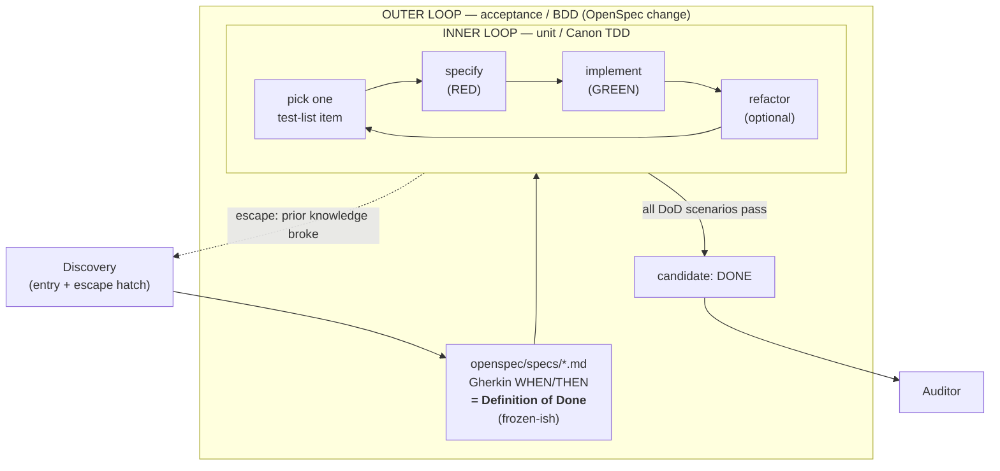
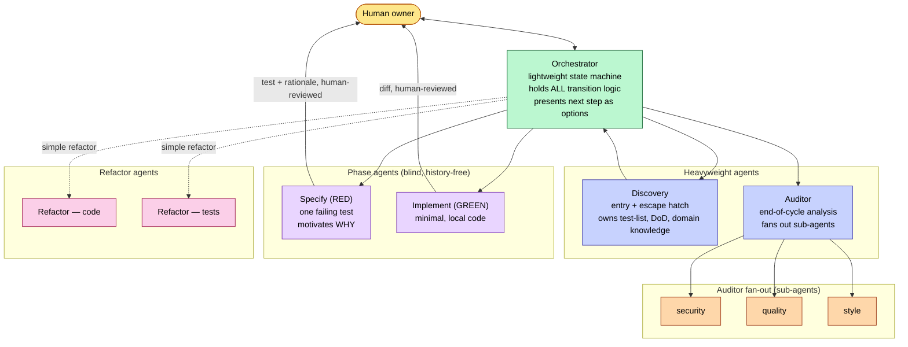

# TDD Orchestration — Intent

> **Status:** Draft intent document. Not yet ratified. This is a *contract* document:
> its purpose is to establish that Human and AI share the same understanding of the
> *shape* of the multi-agent TDD/BDD workflow before a set of OpenSpec changes is
> derived from it. It is design intent, not an enforceable rule set (those live in
> [`governance/constitution.md`](../../governance/constitution.md)).
>
> **Audience:** the Human owner and the agents that will help specify the system.

> **Animating principle:** *Automation should make rigor affordable, not optional.*
> LLMs lowered the cost of *generating* code, not the cost of *knowing it is
> correct*; this whole design points cheap labour at the tedium of the old
> disciplines so that following them is the path of least resistance. See
> [`strategy/goals.md`](../../strategy/goals.md) §1 *Rigor Made Affordable*.

## 1. Purpose

Symphony's core is a collaborative, test-driven development loop in which Human
and AI act as equal partners (see [`governance/vision.md`](../../governance/vision.md),
§1 *Equal Partnership*, §2 *Understanding is Ownership*). This document describes
how that loop works end to end: which agents participate, what artifacts they
exchange, how the loop starts, advances, and escapes, and how it reconciles with
the existing OpenSpec spec-driven workflow.

The design deliberately follows **Canon TDD** (Kent Beck) and **double-loop /
outside-in TDD** (Freeman & Pryce) rather than inventing a bespoke process. Every
structural choice below is motivated by an established source, cited inline and
collected in [§9 References](#9-references). Where we deviate from canonical
practice — principally the introduction of an **orchestrator** — the deviation is
called out and justified in [§7](#7-deliberate-deviations-from-canon-tdd).

## 2. The problem we are solving

Canonical TDD assumes a single developer who silently makes hundreds of
micro-decisions per session: *is this test failing for the right reason? should I
make it pass or start over? is the design ready for the next test? is this
feature done?* (See Kent Beck, *Canon TDD*, steps 2–5.)

In a **multi-agent** setting we cannot let a code-writing sub-agent carry the full
session history — that violates context separation (see
[`AGENTS.md`](../../AGENTS.md), *Context Separation*) and drives cost non-linearly
(GitHub issues [#41](https://github.com/noclearreaction/symphony-maestro/issues/41),
[#42](https://github.com/noclearreaction/symphony-maestro/issues/42),
[#18](https://github.com/noclearreaction/symphony-maestro/issues/18)). We therefore
need to make the silent decision node **explicit and named**, while keeping the
phase agents narrow and history-free.

Two hard constraints from the Human shape the design:

1. **Start from a test list.** The loop begins from a natural-language,
   non-technical list of behaviours to cover, driven by domain knowledge, with a
   defined **Definition of Done (DoD)**. This is Canon TDD step 1
   ([Kent Beck, *Canon TDD*](https://newsletter.kentbeck.com/p/canon-tdd), *Test List*).
2. **Escape to discovery must be cheap.** At any point we may learn that prior
   domain knowledge no longer holds; the workflow must be able to abandon the
   current inner loop and return to discovery quickly. This mirrors Canon TDD's
   "decide whether to push on or start over" moment, promoted to a first-class
   transition.

## 3. Guiding sources (why these choices)

| Choice | Motivated by |
| --- | --- |
| Start with a **test list** of behaviours, not tests | [Kent Beck, *Canon TDD*, step 1](https://newsletter.kentbeck.com/p/canon-tdd); [Fowler, *TestDrivenDevelopment*](https://martinfowler.com/bliki/TestDrivenDevelopment.html) |
| One failing test at a time, "fail for the right reason" | [Kent Beck, *Canon TDD*, step 2](https://newsletter.kentbeck.com/p/canon-tdd); Freeman & Pryce, *GOOS* (see [book site](http://www.growing-object-oriented-software.com/)) |
| Minimal code to green, refactor separately ("two hats") | [Kent Beck, *Canon TDD*, steps 3–4](https://newsletter.kentbeck.com/p/canon-tdd); [Fowler, *TDD*](https://martinfowler.com/bliki/TestDrivenDevelopment.html) |
| **Test list is living** — add/strike items mid-loop | [Kent Beck, *Canon TDD*, step 3](https://newsletter.kentbeck.com/p/canon-tdd) |
| **Double loop**: acceptance (outer) drives units (inner) | Freeman & Pryce, *GOOS* ([book site](http://www.growing-object-oriented-software.com/)); [Dan North, *Introducing BDD*](https://dannorth.net/introducing-bdd/) |
| Acceptance criteria expressed as **Gherkin** WHEN/THEN | [Cucumber, *Gherkin Reference*](https://cucumber.io/docs/gherkin/reference/); [Dan North, *Introducing BDD*](https://dannorth.net/introducing-bdd/) |
| **Walking skeleton** to kick-start the loop before full specs | [Cockburn, *Walking Skeleton* (c2 wiki)](https://wiki.c2.com/?WalkingSkeleton); Freeman & Pryce, *GOOS* |
| Test **ordering** matters and affects design | [Kent Beck, *Canon TDD*, step 2](https://newsletter.kentbeck.com/p/canon-tdd); [Uncle Bob, *Transformation Priority Premise*](https://blog.cleancoder.com/uncle-bob/2013/05/27/TransformationPriorityAndSorting.html) |
| Purpose-built tools, no arbitrary shell | [`governance/vision.md`](../../governance/vision.md) §3; [`governance/constitution.md`](../../governance/constitution.md) §5 |
| Human acknowledgement gates every step | [`governance/constitution.md`](../../governance/constitution.md) §1, §4 |
| Context separation between agent roles | [`AGENTS.md`](../../AGENTS.md), *Context Separation* & *Artifact Boundaries* |

## 4. Core model: double-loop TDD mapped onto OpenSpec

We adopt **double-loop TDD** (Freeman & Pryce, *Growing Object-Oriented Software
Guided by Tests*): an **outer acceptance loop** frames the feature and defines
"done", while an **inner unit loop** drives the implementation one test at a time.
OpenSpec supplies the outer loop; Canon TDD supplies the inner loop.

**Reconciliation summary:**

- **`openspec/specs/*.md` (Gherkin)** is the **outer loop / DoD**. It states the
  observable behaviours the feature must exhibit before it is "done". It is
  frozen enough to be a target; changing it is a deliberate, visible act performed
  via the escape hatch. Grounded in [Cucumber Gherkin](https://cucumber.io/docs/gherkin/reference/)
  and [Dan North's BDD](https://dannorth.net/introducing-bdd/).
- **`test-list` (new artifact)** is the **inner-loop working list** — a living,
  natural-language list of behaviours to drive out. It is finer-grained than the
  acceptance specs and may include unit-level cases discovered mid-loop. It is
  owned by the Discovery agent. Grounded in [Canon TDD step 1](https://newsletter.kentbeck.com/p/canon-tdd).
- **`tasks.md`** is **repurposed** from "implementation plan" to **execution
  ledger** — an append-only record of which red→green→refactor cycles completed
  and their evidence. This resolves the tension noted in issue
  [#42](https://github.com/noclearreaction/symphony-maestro/issues/42): a detailed
  upfront implementation plan is exactly what TDD refuses to produce, so we do not
  pretend to; we record cycles as they happen instead.

## 5. Artifacts (the enrichment set)

An OpenSpec change folder is **enriched** with TDD artifacts. Artifacts — not chat
history — are how agents exchange knowledge across context boundaries
([`AGENTS.md`](../../AGENTS.md), *Artifact Boundaries*).

| Artifact | Owner | Lifecycle | Role |
| --- | --- | --- | --- |
| `proposal.md` | Discovery / Designer | authored at entry | why we are building this |
| `design.md` | Discovery / Designer | authored at entry, amended via escape | architecture decisions |
| `specs/*.md` (Gherkin) | Discovery | outer loop; DoD | acceptance criteria / done |
| **`test-list.md`** | Discovery | **living** — add/strike during loop | inner-loop behaviour backlog |
| **`domain/*.md`** | Discovery | authored + amended on discovery | domain knowledge passed between agents |
| **`tasks.md` (ledger)** | Orchestrator | append-only | evidence trail of completed cycles |
| **`audit/*.md`** | Auditor | authored at end-of-cycle | security/quality/style findings |

The exact filenames and schemas are **not fixed by this document** — they are the
subject of the first OpenSpec change ("TDD artifact vocabulary"). This section
records intent and ownership only.

## 6. The agents

Each agent is narrow, purpose-built, and receives only the context its role needs
([`AGENTS.md`](../../AGENTS.md), *Context Separation*; [`governance/vision.md`](../../governance/vision.md)
§3 *Automation over Intelligence*). Standard, repeatable knowledge gathering is
pushed onto the prompt via **rubato** injection so phase agents do not spend turns
re-deriving repository state (issues
[#41](https://github.com/noclearreaction/symphony-maestro/issues/41),
[#42](https://github.com/noclearreaction/symphony-maestro/issues/42); current
plugins: `git_status`, `go_test`).

### 6.1 Discovery agent (heavyweight)
- **Role:** entry point into the process and the escape hatch out of it. Manages
  the test list, authors the DoD (Gherkin acceptance specs), and maintains domain
  knowledge artifacts.
- **Inputs:** the feature intent, existing project artifacts, domain knowledge.
- **Outputs:** `test-list.md`, `specs/*.md` (DoD), `domain/*.md`, `proposal.md`,
  `design.md`.
- **When invoked:** at the start of a change, and whenever the orchestrator
  determines the inner loop cannot reasonably proceed (knowledge broke, DoD wrong,
  next step unclear). Motivated by [Canon TDD step 1 & the push-on/start-over
  decision](https://newsletter.kentbeck.com/p/canon-tdd).

### 6.2 Orchestrator (lightweight)
- **Role:** a **pure conductor** — a state machine with limited judgment on top.
  It reads test state (via rubato) plus the last phase agent's output artifact and
  decides the next reasonable step. It **holds all transition logic** so the phase
  agents never do. Whenever the next step is not obvious, it escapes to Discovery
  or presents options to the Human.
- **Inputs:** current test state, git state (rubato), the artifact produced by the
  last phase agent, the test list, the DoD.
- **Outputs:** the next transition (as **options presented to the Human**), and
  append entries to the `tasks.md` ledger.
- **Does NOT:** write tests, write code, or carry design history. See
  [§7](#7-deliberate-deviations-from-canon-tdd).

### 6.3 Specify agent — RED (phase, blind)
- **Role:** write exactly **one failing test** that fails **for the right reason**
  (Freeman & Pryce, *GOOS*; [Canon TDD step 2](https://newsletter.kentbeck.com/p/canon-tdd)).
  Cares about test correctness, not implementation.
- **Behaviour:** must be **verbose in motivating WHY** this particular test was
  chosen next (test ordering is a design act —
  [Uncle Bob, TPP](https://blog.cleancoder.com/uncle-bob/2013/05/27/TransformationPriorityAndSorting.html)).
  Asks the Human to review the test **before** any commit.
- **Note:** test-list items need **not** map 1:1 to tests
  ([Canon TDD](https://newsletter.kentbeck.com/p/canon-tdd)).

### 6.4 Implement agent — GREEN (phase, blind)
- **Role:** write the **minimal, local** code to make the single failing test pass
  ([Canon TDD step 3](https://newsletter.kentbeck.com/p/canon-tdd), "make it run,
  then make it right"). Does **not** refactor (two-hats rule).
- **Behaviour:** asks the Human to review the diff **before** any commit.

### 6.5 Auditor agent (heavyweight)
- **Role:** the natural end-of-cycle behaviour. When the orchestrator judges a
  feature (or subset) a candidate for "done", the auditor analyses the code,
  **fanning out sub-agents** for security, quality, style, and refactoring
  opportunities. Motivated by [`vision.md`](../../governance/vision.md) §4
  *Hygiene over Speed* and §3 (narrow sub-agents).
- **Acceptance validation (refutation stance):** the auditor's job is **not to
  prove the work succeeds but to prove it *fails*** — to attack the Gherkin DoD,
  seeking to show it **(a) unreasonable** or **(b) not fulfilled**. A PASS is only
  the *failure to refute* after genuine attack, never "proven correct" (Popper;
  Dijkstra: *testing shows the presence, not the absence of bugs*). This is the
  interim stand-in for executable `godog` acceptance tests, and a lasting
  reinforcement layer thereafter. See
  [`acceptance-validation.md`](acceptance-validation.md).
- **Outputs:** `audit/*.md` findings that may feed refactoring or re-open the loop.

### 6.6 Refactor agents (code, tests)
- **Role:** improve structure without changing behaviour, in the refactor step of
  the loop ([Canon TDD step 4](https://newsletter.kentbeck.com/p/canon-tdd);
  [Fowler, *Refactoring*](https://refactoring.com/)). One agent for production
  code, one for test code.
- **Trigger (open question):** simple refactors may be triggered by the
  orchestrator, but to keep the orchestrator lightweight we expect to **lean on the
  Human** to initiate non-trivial refactors. See [§8](#8-open-questions).

## 7. Deliberate deviations from Canon TDD

**The orchestrator is the one significant addition to canonical TDD, and it is
deliberate.**

In Canon TDD the developer *is* the state machine: the decisions "make it pass vs
start over", "ready for the next test?", "is this done?" happen silently in the
developer's head between every step ([Kent Beck, *Canon TDD*, steps 2–5](https://newsletter.kentbeck.com/p/canon-tdd)).
In a multi-agent system those decisions cannot live inside a phase agent, because:

1. Making a good transition decision requires the **whole picture** (test state,
   history, DoD), which a blind phase agent must not carry (context separation,
   [`AGENTS.md`](../../AGENTS.md)).
2. Duplicating the decision logic into each phase agent would make every phase
   agent heavyweight and inconsistent.

So we **name** that decision node: the orchestrator. It absorbs the human's
implicit short-circuit judgment from Canon TDD, but — crucially — it does **not
act autonomously**. It presents the next step as options and waits for Human
acknowledgement ([`constitution.md`](../../governance/constitution.md) §1, §4). The
common case is "proceed to the next stage"; the escape hatch is "this isn't
working — back to Discovery". The orchestrator stays lightweight by **escalating
whenever the next move is not obvious** rather than reasoning its way through.

Other than the orchestrator (and its human-options gate), the inner loop is Canon
TDD unchanged: test list → one red test (right reason) → minimal green → optional
refactor → repeat until the list is empty and the DoD passes.

## 8. Open questions

1. **Refactor triggering.** Where is the line between "orchestrator triggers a
   trivial refactor" and "Human must initiate"? Leaning Human-initiated to protect
   orchestrator simplicity — needs confirmation.
2. **Artifact schemas.** Exact filenames/structure of `test-list.md`,
   `domain/*.md`, `audit/*.md`, and the `tasks.md` ledger — deferred to the first
   OpenSpec change.
3. **Rubato domain injection.** Whether domain knowledge is injected via a new
   rubato plugin, passed explicitly by the orchestrator when spawning a phase
   agent, or both. Domain knowledge changes during a session, so static caching may
   not fit; needs a small spike.
4. **Escape granularity.** Does an escape always return to Discovery, or can it
   target a lighter "amend the test list" path without a full discovery cycle?
5. **DoD authorship.** Is the DoD purely the Gherkin acceptance set, or does it
   include non-behavioural gates (coverage, audit clean)?
6. **OpenSpec framework skills.** Whether the OpenSpec-provided skills
   (`openspec-explore`, `openspec-propose`, `openspec-apply-change`,
   `openspec-sync-specs`, `openspec-archive-change`) are directly usable by these
   agents or conflict with the TDD loop — to be reconciled before the agent
   contracts are specified.
7. **Acceptance validation horizon.** Long-term the Gherkin DoD becomes executable
   via [`godog`](https://github.com/cucumber/godog); in the interim an AI Auditor
   proves the spec (a) reasonable and (b) fulfilled. The OpenSpec-scenario →
   `.feature` bridge and the auditor's independence mechanics are open — see
   [`acceptance-validation.md`](acceptance-validation.md).

## 9. References

**Primary TDD / BDD sources**
- Kent Beck — *Canon TDD*: <https://newsletter.kentbeck.com/p/canon-tdd>
- Martin Fowler — *Test Driven Development*: <https://martinfowler.com/bliki/TestDrivenDevelopment.html>
- Steve Freeman & Nat Pryce — *Growing Object-Oriented Software, Guided by Tests* (double-loop TDD): <http://www.growing-object-oriented-software.com/>
- Dan North — *Introducing BDD*: <https://dannorth.net/introducing-bdd/>
- Cucumber — *Gherkin Reference* (Given/When/Then): <https://cucumber.io/docs/gherkin/reference/>
- godog — official Cucumber BDD framework for Go (executable acceptance): <https://github.com/cucumber/godog>
- Alistair Cockburn — *Walking Skeleton* (c2 wiki summary): <https://wiki.c2.com/?WalkingSkeleton>
- Robert C. Martin — *The Transformation Priority Premise* (test ordering): <https://blog.cleancoder.com/uncle-bob/2013/05/27/TransformationPriorityAndSorting.html>
- Martin Fowler — *Refactoring*: <https://refactoring.com/>

**In-repo governance / strategy**
- [`AGENTS.md`](../../AGENTS.md) — project context, artifact boundaries, context separation
- [`governance/vision.md`](../../governance/vision.md) — partnership, hygiene, automation, tooling discipline
- [`governance/constitution.md`](../../governance/constitution.md) — human sovereignty, acknowledgement, tooling discipline
- [`strategy/goals.md`](../../strategy/goals.md), [`strategy/decisions.md`](../../strategy/decisions.md)

**Related GitHub issues**
- [#18 — Issue Splitting & Grooming / two-session pattern](https://github.com/noclearreaction/symphony-maestro/issues/18)
- [#41 — Cache-Aware Workflow](https://github.com/noclearreaction/symphony-maestro/issues/41)
- [#42 — Comprehensive Upfront Planning / change record as plan](https://github.com/noclearreaction/symphony-maestro/issues/42)

## 10. Companion documents
- [`tdd-orchestration-scenarios.md`](tdd-orchestration-scenarios.md) — role-played,
  natural-language walkthroughs (happy path, escape-hatch, human-override).
