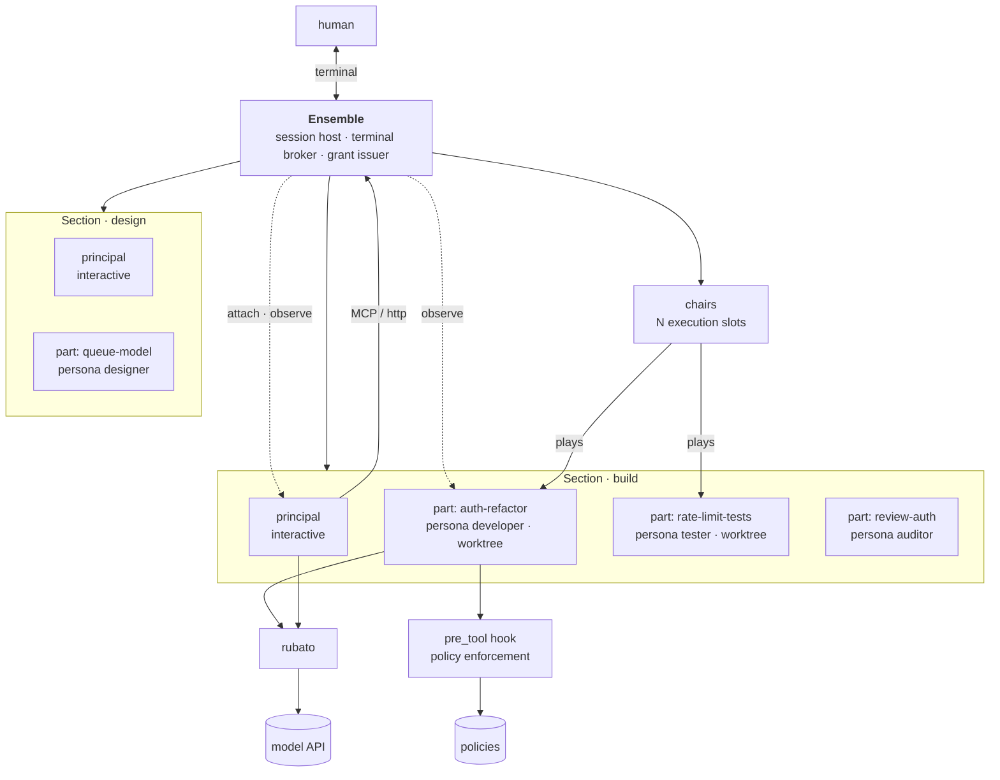
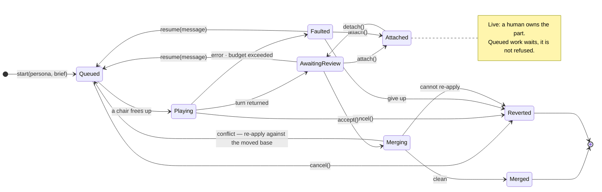
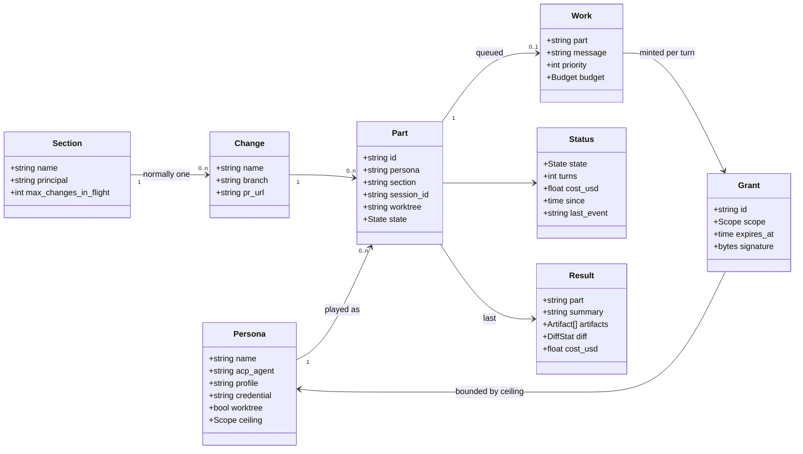
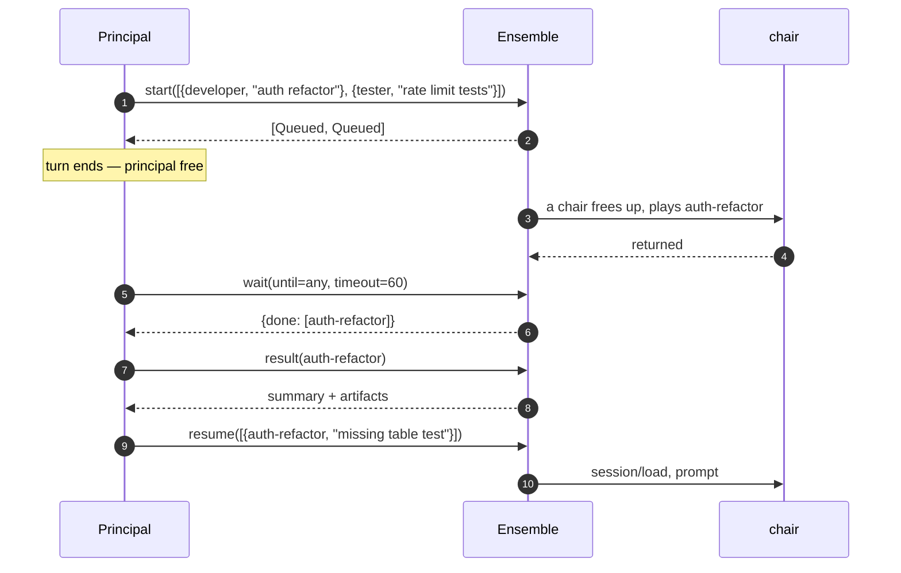
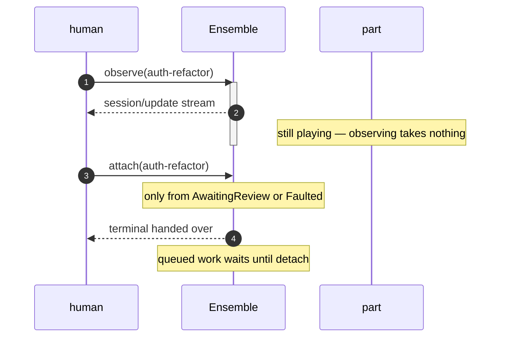
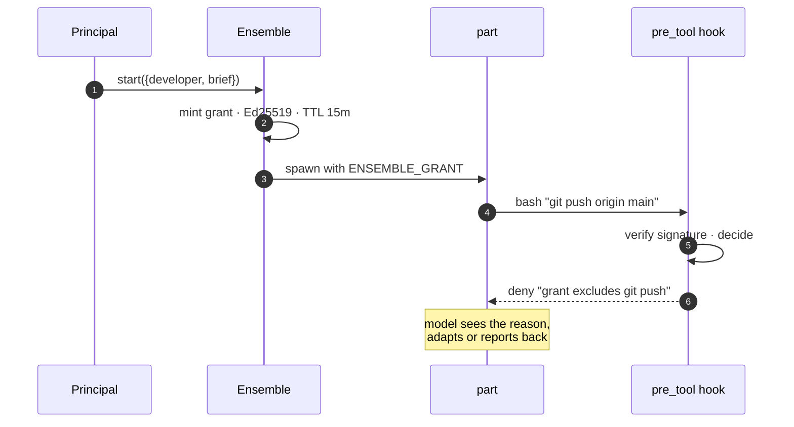

# Ensemble

> **Status: PROVISIONAL — not ratified, not agreed, nothing built.** The substrate
> is not finally committed, the tool surface is unimplemented, and the model below
> has been rewritten more than once as its assumptions failed. Treat every
> specific — names, states, the policy choice — as a proposal to argue with.
>
> Firmer than the rest are the [ground rules](#1-ground-rules) and anything marked
> as measured, because those were verified against a running system rather than
> reasoned about.

Design plan for the orchestration and policy layer that **maestro** directs: an
**orchestration layer** that schedules work and collects results, and a **policy
layer** that hands out privileges the work cannot exceed.

The ground rules were established against Mistral Vibe, since that is what we
run. The design is not tied to it: work is driven over ACP, which several agents
implement — see [One protocol, many agents](#one-protocol-many-agents).

[`scenarios.md`](scenarios.md) walks the same model as narrative. Read it if the
vocabulary below feels abstract — and read Scenario B in particular, which is
where an earlier version of this document was caught conflating a *persona* with
a *part*.

## Vocabulary

Orchestral throughout, and worth stating once. You are not in this table; you sit
outside the metaphor and own it.

| Term | Is |
| --- | --- |
| **Maestro** | The framework. Directs the ensemble. |
| **Ensemble** | This layer: the sections, their parts, and the chairs that play them. |
| **Section** | A long-lived working group — a build section, a design section — with a principal. Works through changes over time. |
| **Change** | The unit that becomes a pull request: an OpenSpec change, its `change/<name>` branch, and the parts working it. |
| **Persona** | A named configuration: which ACP agent, which profile, what authority ceiling, how many may sound at once. `developer`, or `Paul`. |
| **Part** | A unit of work, and the only thing that carries context: a transcript, a worktree, a lifecycle, a completion. |
| **Chair** | An execution slot. Plays one part at a time. |
| **Principal** | The part you land in, playing the orchestrator persona. |

### Why a part, and not a person

The agents have amnesia. Nothing survives a transcript, so context lives entirely
in the part — feature X is one part, feature Y another, and work on X later means
loading X's transcript again.

That makes personas interchangeable. If `Paul` and `Mary` are the same
configuration, either can play any developer part, because neither carries
anything into it. So there is no roster of individuals to hire and no reason to
care which chair takes a part. A persona is a **named configuration that can
sound several times at once**, not a colleague with a memory.

Every job a named colleague seemed to do is done better by something else:

| Wanted | Provided by |
| --- | --- |
| Bounded team size | Per-persona concurrency cap |
| Accumulated context | The part — where it always was |
| Authority scope | The persona |
| Something to address | The part, and *"the auth-refactor part"* beats *"Paul"* |

## 1. Ground rules

Properties of Vibe 2.24.1 that determine the shape of everything else. Each was
verified against the shipped binary; the published docs are silent on most.

| Property | Consequence |
| --- | --- |
| **Delegation is one level deep.** A subagent's `task` tool refuses every target ([`task.py:97`](https://github.com/mistralai/mistral-vibe/blob/v2.24.1/vibe/core/tools/builtins/task.py)). | Hierarchy cannot live inside a session. Orchestration must be an external process. |
| **Only user-facing agents can ask questions.** Subagents return text and cannot prompt. | Approval gates sit with the human. A part never holds one. |
| **Sessions are durable, addressable and resumable.** `--resume <id>` re-enters with full context and appends. | A part *is* a session. Every follow-up is a resume. |
| **`-p` forces a 385-char headless fragment** ending *"Override any earlier instructions that say to wait for confirmation."* Hardcoded in `_run_programmatic_mode()`; no flag disables it. | `-p` turns discovered ambiguity into a silent guess. Ruled out as the substrate. |
| **ACP sessions are not headless.** `vibe/acp/agent.py` omits `headless=` from `SessionOptions`, so it defaults to `False` — verified live: no `# Headless Mode` section, 384 chars shorter than the same work under `-p`. | The verified way to run work programmatically without the fragment. |
| **ACP sessions are ordinary Vibe sessions.** One created over ACP appears in `~/.vibe/logs/session/` under its `sessionId` like any other. | One session store behind both front-ends, so a human can attach with `vibe --resume <id>` whatever drove the part. |
| **Instructions are bound when the process spawns.** ACP offers no way to pick a profile, so `VIBE_DEFAULT_AGENT` at spawn is the lever — measured in [`spikes/acp`](../../spikes/acp/). | A part's persona is fixed for a turn. A process lives for one turn, so this is not a lifetime constraint. |

## 2. Architecture

The human runs Ensemble, not Vibe. Ensemble hosts every session — the
principal's included — and brokers the terminal to whichever the human wants.
It is reached as an MCP server over HTTP for the tool surface, but it does not
sit *under* a session; it sits around all of them.

The principal is not privileged infrastructure. It is the part you land in,
distinguished only by playing the orchestrator persona and holding the
orchestration tools.



Ensemble owns four things and nothing else: the sections and their parts, the
mapping from part to session id, the terminal attachment, and the minting of
grants. It does not interpret results, judge quality, or make plans — those stay
with a principal, the only party that can ask the human.

### Substrate

The constraint that ruled the field: **the headless fragment is not acceptable**,
because it converts ambiguity discovered mid-turn into a silent guess.

| Candidate | Clears it | Standing |
| --- | --- | --- |
| `vibe -p` | No — hardcoded in `_run_programmatic_mode()` | Ruled out |
| **ACP** — [Agent Client Protocol](https://agentclientprotocol.com), JSON-RPC 2.0 over stdio | Yes, verified | Front-runner |
| `vibe/app_server` directly | Unknown — the core both Vibe front-ends sit on | Unexplored |

[`spikes/acp`](../../spikes/acp/) drove ACP end to end against the installed
`vibe-acp`: a real turn, routed through rubato, no headless fragment, and a
system prompt of our choosing. Mistral documents none of it, but the protocol is
not Mistral's — it is a published standard with an agent registry, so the risk is
"Mistral's implementation drifts", not "the contract is someone's internals".

Two spike findings shape what follows:

- **A process lives for one turn.** A session is a transcript on disk and needs
  nothing running; a process is required only while a turn executes. Spawn, load
  or create, prompt, read to `stopReason`, exit. Idle parts cost nothing.
- **`vibe-acp` does not exit cleanly when the client disconnects**, and reports to
  Sentry. Ensemble should close the stream and let it exit rather than killing it.

Still unverified: `session/load`, which every resume depends on.

### One protocol, many agents

ACP is **not Vibe-specific**. Claude Code, Codex CLI, Copilot CLI, OpenCode,
Gemini CLI, Cline and Goose implement it, Claude Code through the
[`claude-agent-acp`](https://github.com/agentclientprotocol/claude-agent-acp)
bridge. Both the spec and that bridge live under the neutral
`agentclientprotocol` org, Apache-2.0 — it is not Zed's, and Mistral implements
it independently.

So a persona names not only *what* a part does but *who plays it*. A section can
mix vendors, and Ensemble stays a client of one protocol rather than a wrapper
around one CLI.

#### Mixed sections are not free

One difference between vendors is contractual rather than technical. Anthropic's
Agent SDK — which the Claude bridge wraps — states that *"unless previously
approved, Anthropic does not allow third party developers to offer claude.ai
login or rate limits for their products, including agents built on the Claude
Agent SDK"*, directing integrators to API keys.

| Persona backed by | Auth | Cost |
| --- | --- | --- |
| Vibe | Mistral account | Included allowance first, then pay-as-you-go |
| Claude | API key, per the terms above | Per token from the first call |

Start Vibe-only. A Claude persona is a deliberate spend, not a free upgrade, and
changing that is a conversation with Anthropic rather than an engineering task.

#### The protocol standardises the conversation, not the configuration

Agent-specific knobs ride in ACP's `_meta`, so how a part is configured differs
per agent even though how it is driven does not. Ensemble needs a small adapter
per agent kind.

| | Vibe | Claude Code (via bridge) |
| --- | --- | --- |
| System prompt | Base replaceable; ten appended fragments, five gated | `_meta.systemPrompt: "…"` replaces outright, no residue |
| Project instructions | `AGENTS.md`, gated with the git snapshot | `settingSources` controls CLAUDE.md loading |
| Tool restriction | `enabled_tools` / `disabled_tools` per profile | `tools`, `disallowedTools`, `disableBuiltInTools` |
| Policy hook | `.vibe/hooks.toml` on disk | `hooks.PreToolUse` passed by the client at session start |

That last row matters for [§6](#6-enforcement). For a Claude-backed part the hook
is supplied by Ensemble when the session opens, rather than read from a file
inside the workspace the part can edit — closing the enforcer-in-the-blast-radius
problem for that agent without containers. Vibe has no equivalent, so the trust
boundary is not uniform across a mixed section, and policy has to assume the
weakest member.

### Shape: one backend, several frontends

A backend daemon with thin, replaceable frontends: CLI, TUI, later a VS Code
extension. Four things make that more than a preference.

**There are two consumer classes.** Principals consume the orchestration tool
surface over MCP; humans consume section views, attach, approvals and logs. Those
want different APIs, and collapsing them is how a tool-shaped API ends up
rendering tables for people.

**The backend is already a server.** It must serve MCP over HTTP regardless, so a
control API for frontends is an increment rather than a new tier.

**State must not live in a frontend**, or the TUI and the CLI become two products
that disagree. A frontend should be able to crash without losing anything.

**Attach is where the split gets tested**, and the one place frontends cannot be
uniform:

| Frontend | Attach means |
| --- | --- |
| CLI | exec `vibe --resume <id>` in the foreground — trivial |
| TUI | suspend itself and hand over the terminal, or embed a pty — the hard case |
| VS Code | likely open Vibe's own extension against the session rather than reimplementing it |

So `attach` is a backend-blessed capability — the backend says which session and
why — with a per-frontend mechanism.

#### CLI first

Not because it is cheapest, though it is. Because it validates the control API
without UI work confounding the question: if the CLI can drive the ensemble, the
API is complete. It stays useful permanently as the scripting surface, and it
makes owning attachment trivial to prove.

The trap is that a CLI naturally polls and exits, and a poll-shaped CLI bakes a
poll-shaped API. The TUI wants a live view, which is a subscription. So the first
CLI must include the `tail`-shaped observer — the smallest thing forcing a real
event stream into the API, after which the TUI is a rendering problem rather than
an API redesign.

The TUI is the eventual daily driver, since watching and reviewing beats issuing
one-shot commands. VS Code comes last and may be smaller than it sounds: Vibe's
own extension already provides the session UI, so Ensemble's part could be a
section panel that launches an attach.

## 3. Parts

### One owner at a time

**A part has exactly one owner.** Either Ensemble is driving it on scheduled work,
or a human is driving it interactively. Never both.

The reason is meaning, not concurrency safety. Two writers on one transcript break
both: the scheduler gets back a conversation containing turns it never sent, and
the human finds their session doing things they did not ask for. Neither can
reason about a conversation it only partly authored.

**Owning attachment** is interactive — the human takes the part and drives it. A
part is *live* when `Playing` or `Attached`, and a live part does not take work
off the queue. Queued work is not rejected; it waits, and starts when the human
detaches.

**Observing** is read-only and takes nothing. It streams the same
`session/update` notifications the driver sees, works in any state including
mid-turn, and any number can watch at once. In the CLI it is a `tail`-shaped
command; in the TUI it is what the section view is made of.

Keeping those separate is what lets you watch work happen without stopping it.

Later, the wait becomes a choice: show a part's queued work in the TUI and let the
human **pull** it into the session they are already in, rather than detaching and
letting the scheduler start it. Same exclusivity, with the handoff deliberate
instead of merely timed.

### Lifecycle



### Merged or reverted

**A part is done when its branch is merged.** Those are the only two ends, and
both are clean.

Merge is attempted **once**, at the end of the work — not per turn. Turns run
until the orchestrator accepts the part, and that judgment is about quality and
completeness. Any change at all is enough to proceed to a merge, **including a
partial one**: a part that made a coherent dent and merged has succeeded, and
whether the original problem is fully solved is answered by enqueuing more work,
not at the integration boundary.

Merge only happens clean. A conflict is **a signal to the part that caused it** —
it goes back through the queue with the moved base and re-applies its own change:

> "Your base has moved. `internal/auth/token.go` now looks like this. Re-apply
> your change against it."

That is what a developer does when a rebase turns ugly, and it beats handing the
conflict to a fresh part: the part that formed the intent is still there with its
reasoning intact, where a resolver would have to infer two intents from diffs.

If it cannot re-apply, the part **fails and its worktree is reverted**. Failure is
therefore clean — nothing half-integrated, nothing for a human to unpick, no tree
left behind. The change either landed or never existed.

Ordering falls out of completion order: first to merge wins, second re-applies.

Three tiers, in cost order — avoid by sharing a worktree, re-apply, or escalate to
a human when a part cannot re-apply its own change, since a second attempt will
not fix that.

> **Unverified.** Whether an agent reliably re-applies its intent against a moved
> base is an empirical question. If it does not, the answer collapses to the first
> tier: share more worktrees, run less concurrently, and pay in wall-clock rather
> than in integration.

`resume` is deliberately general. Rejected output is one reason; a follow-up
question, new information, a conflict to re-apply, or a change of direction are
others. There is no separate `reject` verb — rejection is a resume whose message
says what was wrong. Resuming continues the existing transcript rather than
starting a new one: cheaper, since cached input bills at a tenth of fresh, and
correct, since the context that produced the work is still there.

`Faulted` is not retried automatically. A part that ran out of budget mid-edit
has left a worktree a human should see.

### Starting is not playing

`start` puts a part on the queue. It begins playing when a chair is free and the
part is not live — neither `Playing` nor held `Attached`. Until then it waits, and
`start` fails for neither reason.

**The queue only ever holds ready work.** Sequencing is the orchestrator's
judgment, not a mechanism: it does not enqueue "write the code" and "write the
test" together and leave a scheduler to work out the order — it enqueues the code
once the test exists. There is no dependency graph to evaluate, and termination is
structural rather than hoped for, because the work set is finite and nothing enters
the queue before it can run.

**A part's worktree is created at enqueue, not at selection.** That is the moment
the intended base state is known — the test exists, at *this* commit. Defer
creation to selection and the part branches from whatever HEAD has since become,
which is not what was decided.

### What bounds concurrency

Three configured constraints, each traceable to a real cause, all operator
configuration and none reachable from a tool:

| Constraint | Because |
| --- | --- |
| **Chairs** | Total spend and rate-limit exposure |
| **Per-credential concurrency** | The provider actually limits this — per account, not per persona |
| **Section reservation, then share** | One section must not stall another; reserve a minimum, share the surplus so idle sections do not waste chairs |

There is deliberately **no per-persona cap**. Two parts playing the same persona
are identical configuration, so a headcount limit says nothing about why. What it
would be standing in for is a credential's rate limit, which is where the
constraint belongs.

Chairs have no relationship to parts. Ten parts and one chair is ordinary, and so
is the reverse. The bound exists for tokens, spend and provider rate limits — not
CPU, since a chair spends nearly all its time waiting on a model API. Sizing it
like a CPU-bound pool would be a category error.

Beyond configuration, work can also be excluded by contention: parts needing the
same **mutex** cannot play at once. Mutexes are acquired atomically at dispatch —
a part gets its whole set or waits holding nothing — so there is no hold-and-wait
and therefore no deadlock. A mutex is held for the life of the part, not the turn,
because a worktree that shifts between turns leaves a part re-entering a checkout
its own transcript no longer matches.

The commonest mutex is a worktree, and there it is a correctness requirement
rather than a preference: **dependent work shares a worktree because it needs its
predecessor's output.** "Write the code" must see the test. Serialisation is what
"this builds on that" means, not a scheduling choice — and the scheduling
consequence follows from the logical structure of the work rather than driving it.

Independent work gets separate worktrees, runs concurrently, and pays at merge if
it turns out to overlap.

### Git is Ensemble's, not a part's

Creating the worktree, naming the branch, attempting the merge and reverting on
failure are **Ensemble's**. They are mechanical, they must be deterministic, and
nothing about them benefits from being model-mediated. A part edits files inside
its worktree and nothing else.

So **no persona needs git**, and a ceiling can deny it outright. That is worth
stating because it removes a whole agent: the `git-operator` of
[`tdd-orchestration-intent.md`](../design/tdd-orchestration-intent.md) §6 existed
to keep git commands away from other agents, and once git is infrastructure rather
than work, there is nothing for it to do.

The one boundary is **committing**. Mechanically it is Ensemble's, but a commit
message is content, and this repository cares about it — see
[`bin/commit-lint.ts`](../../bin/commit-lint.ts). The split that respects both:
the part proposes the message as part of its result, Ensemble makes the commit and
validates it. A part that proposes an unlintable message gets told, in the same
way it gets told about a conflict.

### Two levels of git

Part branches do not merge into `main`. They merge into a **change** branch, and
the change is what becomes a pull request.

```
main
 └── change/rate-limiting            integration branch for one change
      ├── part/rate-limit-impl       part branches merge here
      ├── part/rate-limit-tests
      └── part/rate-limit-review
```

The change is not a new concept — it is **the OpenSpec change already named in
`openspec/changes/<name>/`**, on the `change/<name>` branch this repository
already uses. One identity, three manifestations: a folder of artefacts, a branch,
and the parts working it.

Ensemble owns both levels of plumbing: create the change branch, create part
branches, merge parts, open the PR, set its body from the change's proposal. What
it does **not** do is merge the PR. That is the human's, and it is where
[`governance/constitution.md`](../../governance/constitution.md) §1 puts the gate —
agents propose and execute, the human decides what reaches `main`.

A section is long-lived and works through many changes over time. It **should**
work them sequentially, one change in flight at a time, because concurrent changes
in one section is how you get the conflicts of [§3](#merged-or-reverted) without
the isolation of separate sections to justify them. But that is a **default, not
an invariant** — expressed as a configured limit on changes in flight, defaulting
to one. Claiming to know exactly how a git flow always works is how a design
acquires a rule someone has to fight later.

## 4. Functional contract

The MCP tool surface. Every call is batch-shaped: each tool boundary is a
potential turn, and every turn re-sends the whole context, so instructing five
parts must cost one turn rather than five.



### Tool surface

| Tool | Blocks | Returns | Semantics |
| --- | --- | --- | --- |
| `personas()` | no | `Persona[]` | What can be played: names, caps, current concurrency. Read-only — personas change by review, not by call. |
| `parts()` | no | `Part[]` | The calling principal's section: ids, personas, states, queued work. |
| `start(items[])` | no | `Part[]` | `{persona, brief, priority?}`. Creates parts and queues their first turn. Does not fail for capacity or liveness. |
| `start_sync(items[], timeout)` | yes | `Result[]` | Start and wait in a single turn — the reason it exists. |
| `resume(items[])` | no | `Part[]` | `{part, message}`. Queues another turn on an existing transcript. |
| `wait(parts?, until, timeout)` | yes | `WaitResult` | `until` is `any` or `all`. Server caps the timeout and returns `pending` rather than hanging. |
| `status(parts?)` | no | `Status[]` | Cheap poll. Omit `parts` for the whole section. |
| `result(part, full?)` | no | `Result` | Summary by default; `full` returns the diff. |
| `accept(parts[])` | no | `Part[]` | Done with the work. Ensemble attempts the merge: clean means `Merged`, a conflict sends the part back to re-apply. |
| `cancel(parts[])` | no | `void` | Drops queued work, or stops a playing turn and keeps the transcript for inspection. |

### Invariants

- **No call hangs.** Blocking tools take a server-side cap — 60s working default —
  and return `{status: "pending"}` so the model can call again. MCP requests time
  out at both ends, and a hung call also freezes the principal against its human.
- **Results are summaries.** Full diffs only on request. Five parts reporting must
  not paste five diffs into the principal's context. Ensemble builds a `Result`
  from what the substrate returns — the final message is the summary, reasoning
  is dropped.
- **Context lives in the part, and nowhere else.** There is no cross-part memory,
  because the agents have none.
- **Scope is per turn, bounded by persona.** The grant is minted when work is
  queued and is always at or below the persona's ceiling. No call widens a
  persona.
- **Parts are durable.** They survive an Ensemble restart, because a part is a
  transcript on disk and a row of state, not a process.

### How results reach the principal

Through `wait`, and only through `wait`. A principal is a live interactive
session, and a live session cannot be driven from outside — so there is no
callback path and no delivery queue. The principal asks; Ensemble answers when it
has something.

Ensemble owns the terminal, so it *could* type into a live session. It does not,
for the same reason a part has one owner.

## 5. Dispatch flows





## 6. Enforcement

The enforcement point is a `pre_tool` hook, which fires before the permission
prompt and can deny with a reason returned to the model as the tool error: verify
the grant's signature, evaluate the call, allow or deny.



Two things from our own [`.vibe/hooks.toml`](../../.vibe/hooks.toml) matter here.
Hooks **fail open** — *"anything else / non-zero → fails OPEN with a UI warning"* —
so `strict = true` is mandatory on the policy hook, not optional. And the hook
runs in the part's own process tree, so a part that can write `.vibe/hooks.toml`,
replace the hook binary, or re-sign its grant has disarmed the policy.

### Design considerations

**Where the trust boundary sits.** The hook runs inside what it polices, so it is
only as strong as that part's inability to edit it.

| Position | Strength | Cost |
| --- | --- | --- |
| Hook alone | Advisory. Adequate while parts are fallible rather than adversarial. | None beyond the hook. |
| Hook, denying its own paths | Closes the obvious route. Still one policy bug from disarmed. | Policy must protect itself from version one. |
| Container per turn | Boundary is the kernel's. The hook becomes defence in depth. | Worktrees become mounts and Ensemble supervises containers — but a container lives for one turn, so nothing idles. |

Worth settling before policy is written, because the third changes the deployment
model rather than the configuration.

**How sections reach each other.** Open, and worth leaving open. Either the repo
is the medium and sections communicate through branches, changes and issues; or
the human is the medium, carrying intent across by switching sessions; or Ensemble
relays with an explicit `message(section, text)`. The first two need no mechanism
and should be tried first. The third is buildable, but a section that can message
another section's principal is a section that can task it, and persona ceilings
say nothing about that.

**What survives an Ensemble restart.** More than it first appears. A part is a
transcript on disk and a row of state, so durability is close to free. What cannot
survive is a turn in flight, since the process running it dies with its parent.
The choice is whether Ensemble supervises those or lets them come back `Faulted`
with worktrees intact. The second is cheaper and honest, and should be a decision
rather than a consequence.

**Whether a turn is at-most-once.** Work that edited files and then lost its
result channel has still done the work. Since the worktree persists and the
transcript is resumable, recovery is inspection rather than replay — an argument
for worktrees arriving early.

## 7. Policy options

The PAM analogy covers two separable problems, and conflating them is what leads
to building something bespoke.

- **Delegation** — how a grant reaches a part, narrowed on the way.
- **Decision** — whether *this* tool call, with these arguments, is permitted.

Ensemble is TypeScript on Deno, so the question is what runs there rather than
what has a Go binding.

| Candidate | Kind | Deno support | Standing |
| --- | --- | --- | --- |
| **[Cedar](https://www.cedarpolicy.com/)** | decision engine | `@cedar-policy/cedar-wasm` 4.12.0, official — loads under Deno, verified | **live option** |
| **[Biscuit](https://www.biscuitsec.org/)** | capability token **and** Datalog policy | `@biscuit-auth/biscuit-wasm` 0.6.0, official — npm last published 2025-09-26, repo pushed 2026-07-13 | **live option** |
| **[OPA / Rego](https://www.openpolicyagent.org/)** | decision engine | `@open-policy-agent/opa-wasm` | alt — more expressive, heavier, another language |
| **Macaroons** | capability token | bindings only | no — weaker expression, HMAC wants a shared secret |
| **[UCAN](https://github.com/ucan-wg/spec)** | capability token | — | no — DIDs and token bloat for no benefit here |
| **Casbin** | policy library | — | no — awkward for rich per-call attributes |

Cedar is fast, analyzable and exposes `isAuthorized` directly, but has no
delegation semantics and needs a companion grant format. Biscuit would collapse
both into one mechanism, since the token carries its own checks — at the cost of
learning Datalog, and with an npm publishing gap that wants explaining.

**The choice is deliberately deferred.** What will separate them is writing one
real policy — deny `git push` for a persona scoped to a worktree — and seeing
which reads better.

### The load-bearing observation

Offline attenuation exists because the delegating party **cannot reach the
issuer**. Here Ensemble *is* the issuer, and the principal is talking to it over
MCP at the moment work is queued. So Ensemble can mint a narrowed, short-lived
grant per turn and no attenuation format is strictly needed.

That weakens the case for Biscuit's headline feature without settling the choice:
attenuation is one thing Biscuit does, carrying policy inside the token is the
other.

## 8. Build order

Each stage is independently useful, and each is a place to stop if the value is
not there.

| Stage | Delivers | Proves |
| --- | --- | --- |
| 0 ✅ | **ACP spike** — [`spikes/acp`](../../spikes/acp/). | Done. A real turn, routed through rubato, no headless fragment, instructions ours via `VIBE_DEFAULT_AGENT`. |
| 1 | `session/load` on the spike. | Resume works over ACP — the assumption every review round depends on. |
| 2 | Backend plus CLI: host a part, own-attach to it, and `tail` it. | The entrypoint, and an event stream in the control API before anything is built on it. |
| 3 | Personas from configuration; `personas`, `parts`, `start`, `status`. Durable across restart. | Work can be started and survives Ensemble dying. |
| 4 | `wait`, `result`, the queue, chairs, and a worktree per part. | Work comes back, bounded by chairs rather than by how much was started. |
| 5 | `resume`, `accept`, the merge and re-apply on conflict, plus owning attach in `AwaitingReview`. | The review loop, and that a part either merges or reverts cleanly. |
| 6 | Grants and the policy hook. | A part is provably unable to exceed its persona's ceiling. |
| 7 | A second section. | Sections are a first-class boundary. |
