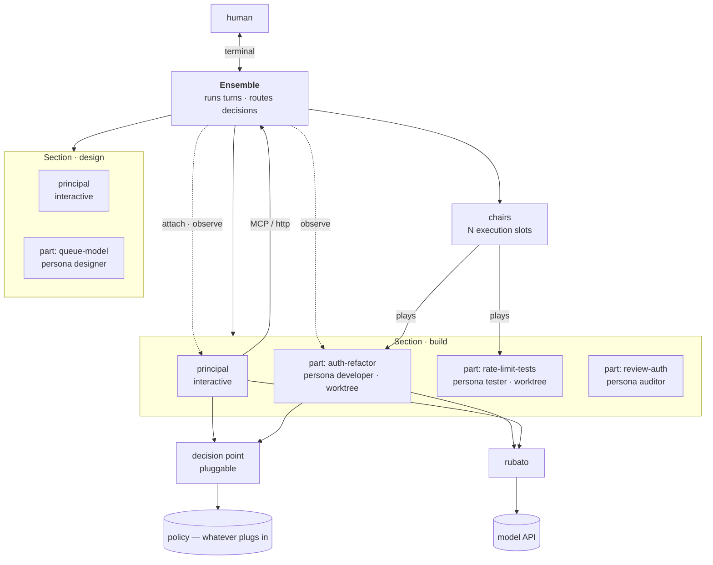
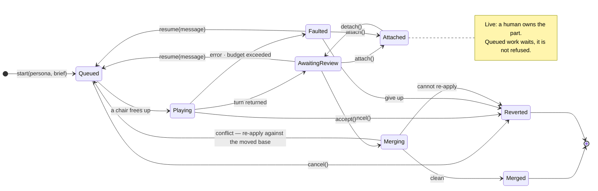
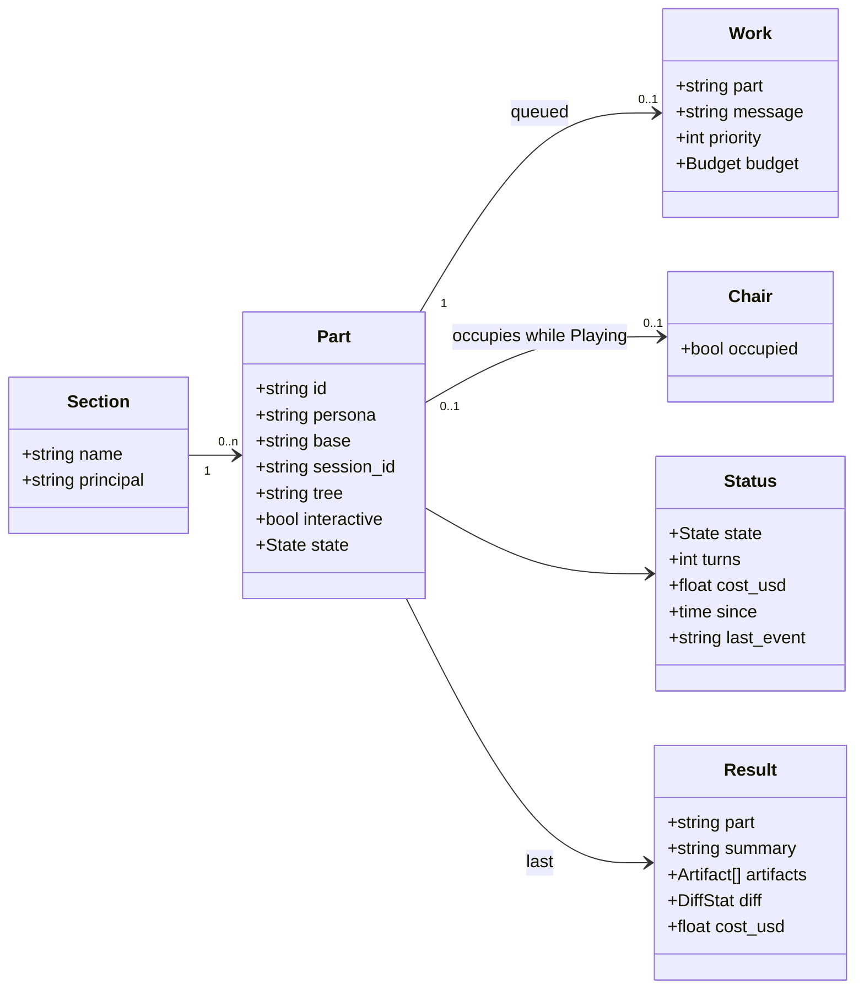
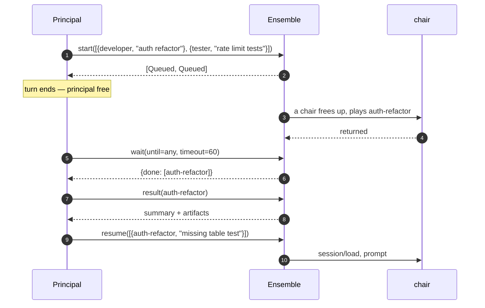
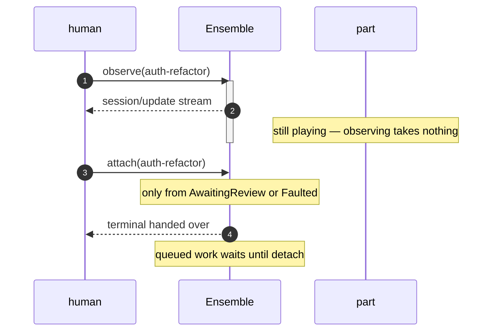

# Ensemble

> **Status: PROVISIONAL — not ratified, not agreed, nothing built.** The substrate
> is not finally committed, the tool surface is unimplemented, and the model below
> has been rewritten more than once as its assumptions failed. Treat every
> specific — names, states, the policy choice — as a proposal to argue with.
>
> Firmer than the rest are the [constraints](#1-constraints) and anything marked as
> measured, because those were verified against a running system rather than
> reasoned about.

Design plan for the orchestration and policy layer that **maestro** directs: an
**orchestration layer** that schedules work and collects results, and a **policy
layer** that hands out privileges the work cannot exceed.

[`scenarios.md`](scenarios.md) walks the same model as narrative. Read it if the
vocabulary below feels abstract — and read Scenario B in particular, which is
where an earlier version of this document was caught conflating a *persona* with
a *part*.

## Vocabulary

Orchestral throughout, and worth stating once. You are not in this table; you sit
outside the metaphor and own it.

| Term | Is |
| --- | --- |
| **Maestro** | The framework. Directs the ensemble. |
| **Ensemble** | This layer: the sections, their parts, and the chairs that play them. |
| **Section** | A long-lived working group — a build section, a design section — with a principal. |
| **Base** | The git ref a part's worktree is created from and merged back into. What it signifies is the project's business, not Ensemble's. |
| **Persona** | An instruction set, and which ACP agent runs it — `developer`, `auditor`. Nothing more: not a tree, not a permission, not an individual. |
| **Ceiling** | What a persona's parts may do. Reviewed configuration, bound to a persona by the operator rather than carried by it. |
| **Part** | A unit of work, and the only thing that carries context. Has a transcript, a persona, a tree or none, an interactive flag, and a lifecycle. |
| **Chair** | An execution slot. Plays one part at a time. |
| **Principal** | A part whose properties are: orchestrator persona, works in the base itself, interactive, wide ceiling. Not a separate kind of thing. |

### Everything is a part

The agents have amnesia: nothing survives a transcript, so context lives entirely
in the part. Two parts running the same persona are therefore indistinguishable,
and there is no individual to name or track.

One kind of thing, carrying four properties:

| Property | Values |
| --- | --- |
| **Persona** | Which instruction set, and which agent runs it |
| **Tree** | A worktree of its own, the base itself, a read-only checkout for review, or none |
| **Interactive** | Whether a human is driving it, rather than a brief |
| **Ceiling** | What it may do — from reviewed configuration, keyed by its persona |

The principal is a combination of those rather than an exception to them, which
keeps scheduling, enforcement and the lifecycle uniform and makes *"run a
principal unattended overnight"* a flag rather than a new concept:

| | Developer part | Principal |
| --- | --- | --- |
| Git | None | Whatever its ceiling allows |
| Tree | A worktree from the base | The base itself |
| Interactive | No | Yes |
| Ends when | Its work merges into the base | A human says so |

**The ceiling is not part of the persona.** A persona is a prompt, a
ceiling is a policy, and the operator's configuration binds one to the other. That
separation is what stops a principal handing a part more authority than a human
sanctioned.

## 1. Constraints

Ensemble drives work over **ACP**, the [Agent Client Protocol](https://agentclientprotocol.com).
Several agents implement it — Vibe, Claude Code, Codex CLI, Copilot CLI, OpenCode,
Gemini CLI, Cline, Goose — so this layer is a client of one protocol rather than a
wrapper around one CLI, and a part can be run by any of them.

Five properties of that substrate shape everything below. They were measured, not
assumed; the evidence is in [`spikes/acp`](../../spikes/acp/) and
[`docs/vibe/prompt/`](../vibe/prompt/).

| Constraint | Consequence |
| --- | --- |
| A session is a durable transcript, addressable and resumable. | A part *is* a session. Continuing one is a resume, and durability comes free. |
| A process serves one turn, and instructions are bound when it starts. | Idle parts cost nothing, and a part's persona is fixed for a turn rather than for its life. |
| Delegation inside a session is one level deep. | Hierarchy cannot live in a session, so orchestration is an external process. |
| A non-interactive agent cannot ask a question, but its tool calls still raise permission requests — and those reach the client. | Ensemble must answer them. See [§6](#6-tool-use-with-no-human-present). |
| Configuration is per agent, not per protocol. | Ensemble needs a small adapter per agent kind — applying instructions differs between them even though driving a session does not. |

One thing the substrate does *not* give us, and it is why ACP rather than a CLI:
an agent run headlessly is typically instructed to make a judgment call and press
on rather than stop. That converts ambiguity a part discovers mid-turn into a
silent guess, and it is not acceptable in work that gets reviewed. ACP sessions do
not carry it.

> **Not free across vendors.** Work run by Vibe draws on a Mistral subscription;
> work run by Claude Code is directed to API keys by Anthropic's Agent SDK terms.
> Mixing agents in one section is a deliberate spend, not a free upgrade.

## 2. Architecture

Ensemble knows which parts exist, which session id each one is, and runs their
turns. A principal reaches it over MCP; a human through the CLI.

Attaching is a lookup rather than a feature: a session is resumable by the agent's
own command, so Ensemble supplies the session id and the CLI execs the agent
against it.

The principal is a part like any other, with the properties set out in
[Everything is a part](#everything-is-a-part): the orchestrator persona, the base
as its tree, interactive, and a wide ceiling. It is scheduled, enforced and
tracked by the same machinery as the rest.

Ensemble owns the sections and their parts, the mapping from part to session id,
the queue, and routing permission requests to whatever decides them. It does not
interpret results, judge quality, make plans, or decide policy.

### Shape: one core, several entry points

**The core is file-backed state and the logic over it** — part records,
transcripts, worktrees, the queue — all on disk. Entry points are spawned on
demand and share nothing but those files: an MCP server, a CLI, later a TUI and an
extension.

The filesystem carries the coordination: a lock bounds how many turns run at once,
and any invocation can start queued work when a chair frees. A turn is driven by a
process living exactly as long as the turn — the same process that is the ACP
client, and therefore what answers permission requests — which writes its result
where the next reader will find it.

The MCP surface exists for an agent making tool calls. A human wants something
different from the same state: which parts exist, what they are doing, attach,
logs. One interface shaped for tool calls serves that badly, which is why the
entry points are separate rather than one surface with two audiences.

State stays in the core rather than an entry point, so the TUI and the CLI cannot
disagree, and any of them can crash without losing anything.

**Attach is where the split gets tested**, and the one place entry points cannot
be uniform:

| Frontend | Attach means |
| --- | --- |
| CLI | exec the agent against the session in the foreground — trivial |
| TUI | suspend itself and hand over the terminal, or embed a pty — the hard case |
| VS Code | likely open the agent's own extension against the session rather than reimplementing it |

The core decides whether a part can be attached at all — it is in an attachable
state, and nobody else owns it — and hands over the session id. Getting a terminal
onto that session is the entry point's job.

#### CLI first

Not because it is cheapest, though it is. Because it validates the control API
without UI work confounding the question: if the CLI can drive the ensemble, the
API is complete. It stays useful permanently as the scripting surface, and it
makes owning attachment trivial to prove.

The trap is that a CLI naturally polls and exits, and a poll-shaped CLI bakes a
poll-shaped API. The TUI wants a live view, which is a subscription. So the first
CLI must include the `tail`-shaped observer — the smallest thing forcing a real
event stream into the API, after which the TUI is a rendering problem rather than
an API redesign.

The TUI is the eventual daily driver, since watching and reviewing beats issuing
one-shot commands. VS Code comes last and may be smaller than it sounds: where an
agent ships its own extension, Ensemble's part could be a section panel that
launches an attach rather than a session UI.

## 3. Parts

### One owner at a time

**A part has exactly one owner.** Either Ensemble is driving it on scheduled work,
or a human is driving it interactively. Never both.

The reason is meaning, not concurrency safety. Two writers on one transcript break
both: the scheduler gets back a conversation containing turns it never sent, and
the human finds their session doing things they did not ask for. Neither can
reason about a conversation it only partly authored.

**Owning attachment** is interactive — the human takes the part and drives it. A
part is *live* when `Playing` or `Attached`, and a live part does not take work
off the queue. Queued work is not rejected; it waits, and starts when the human
detaches.

**Observing** is read-only and takes nothing. It streams the same
`session/update` notifications the driver sees, works in any state including
mid-turn, and any number can watch at once. In the CLI it is a `tail`-shaped
command; in the TUI it is what the section view is made of.

Keeping those separate is what lets you watch work happen without stopping it.

Later, the wait becomes a choice: show a part's queued work in the TUI and let the
human **pull** it into the session they are already in, rather than detaching and
letting the scheduler start it. Same exclusivity, with the handoff deliberate
instead of merely timed.

### Lifecycle

### Merged or reverted

**A part is done when its branch is merged.** Those are the only two ends, and
both are clean.

Merge is attempted **once**, at the end of the work — not per turn. Turns run
until the orchestrator accepts the part, and that judgment is about quality and
completeness. Any change at all is enough to proceed to a merge, **including a
partial one**: a part that made a coherent dent and merged has succeeded, and
whether the original problem is fully solved is answered by enqueuing more work,
not at the integration boundary.

Merge only happens clean. A conflict is **a signal to the part that caused it** —
it goes back through the queue with the moved base and re-applies its own change:

> "Your base has moved. `internal/auth/token.go` now looks like this. Re-apply
> your change against it."

That is what a developer does when a rebase turns ugly, and it beats handing the
conflict to a fresh part: the part that formed the intent is still there with its
reasoning intact, where a resolver would have to infer two intents from diffs.

**Presented as an artefact, not as a git operation.** Ensemble resets the part's
worktree to the moved base and hands it its own previous diff. No conflict
markers, no `--theirs`, no git tooling added to the part's ceiling — it edits
files exactly as it always does, which is the thing it is good at rather than a
git operation it is bad at.

If it cannot re-apply, the part **fails and its worktree is reverted**. Failure is
therefore clean — nothing half-integrated, nothing for a human to unpick, no tree
left behind. The work either landed or never existed.

Ordering falls out of completion order: first to merge wins, second re-applies.

Three tiers, in cost order — avoid by sharing a worktree, re-apply, or escalate to
a human when a part cannot re-apply its own change, since a second attempt will
not fix that.

> **Unverified.** Whether an agent reliably re-applies its intent against a moved
> base is an empirical question. If it does not, the answer collapses to the first
> tier: share more worktrees, run less concurrently, and pay in wall-clock rather
> than in integration.

`resume` covers more than rejection. Rejected output is one reason; a follow-up
question, new information, a conflict to re-apply, or a change of direction are
others. There is no separate `reject` verb — rejection is a resume whose message
says what was wrong. Resuming continues the existing transcript rather than
starting a new one: cheaper, since cached input bills at a tenth of fresh, and
correct, since the context that produced the work is still there.

`Faulted` is not retried automatically. A part that ran out of budget mid-edit
has left a worktree a human should see.

### Starting is not playing

`start` puts a part on the queue. It begins playing when a chair is free and the
part is not live — neither `Playing` nor held `Attached`. Until then it waits, and
`start` fails for neither reason.

**The queue only ever holds ready work.** Sequencing is the orchestrator's
judgment, not a mechanism: it does not enqueue "write the code" and "write the
test" together and leave a scheduler to work out the order — it enqueues the code
once the test exists. There is no dependency graph to evaluate, and termination is
structural rather than hoped for, because the work set is finite and nothing enters
the queue before it can run.

**A part's worktree is created at enqueue, not at selection.** That is the moment
the intended base state is known — the test exists, at *this* commit. Defer
creation to selection and the part branches from whatever HEAD has since become,
which is not what was decided.

### What bounds concurrency

Three configured constraints, each traceable to a real cause, all operator
configuration and none reachable from a tool:

| Constraint | Because |
| --- | --- |
| **Chairs** | Total spend and rate-limit exposure |
| **Per-credential concurrency** | The provider actually limits this — per account, not per persona |
| **Section reservation, then share** | One section must not stall another; reserve a minimum, share the surplus so idle sections do not waste chairs |

Nothing is capped per persona: a headcount says nothing about why, where a
credential's rate limit is the constraint that actually exists.

Chairs have no relationship to parts. Ten parts and one chair is ordinary, and so
is the reverse. The bound exists for tokens, spend and provider rate limits — not
CPU, since a chair spends nearly all its time waiting on a model API. Sizing it
like a CPU-bound pool would be a category error.

Beyond configuration, work can also be excluded by contention: parts needing the
same **mutex** cannot play at once. Mutexes are acquired atomically at dispatch —
a part gets its whole set or waits holding nothing — so there is no hold-and-wait
and therefore no deadlock. A mutex is held for the life of the part, not the turn,
because a worktree that shifts between turns leaves a part re-entering a checkout
its own transcript no longer matches.

The commonest mutex is a worktree, and there it is a correctness requirement
rather than a preference: **dependent work shares a worktree because it needs its
predecessor's output.** "Write the code" must see the test. Serialisation is what
"this builds on that" means, not a scheduling choice — and the scheduling
consequence follows from the logical structure of the work rather than driving it.

Independent work gets separate worktrees, runs concurrently, and pays at merge if
it turns out to overlap.

### Who owns git

Not one answer — the two levels have different owners, because one is mechanical
and the other is judgment.

| Level | Owner | Why |
| --- | --- | --- |
| Part worktrees, commits, merge into the base, revert on failure | **Ensemble** | Mechanical, must be deterministic, triggered by `accept`. Ensemble created those trees. |
| Anything above the base — where it came from, where it goes next | **The principal** | Judgment and authored content, and the principal is already working in the base. |

A part's ceiling can deny git outright, since it never needs it. A principal's
cannot, and it should not get git through tools wrapping it either: git flows
vary, and a principal with git and judgment adapts where one with a fixed set of
verbs is stuck with whatever we imagined.

Where the hard boundary belongs is **outside Ensemble** — a protected ref, so it
holds regardless of what any agent attempts. A ceiling we wrote is a weaker
guarantee than one the remote enforces.

Committing a part's work is Ensemble's, but the message is content, so the part
proposes it in its result and Ensemble commits with it. Whether a message is
checked against a project's conventions is that project's business, and a
rejection comes back the same way a conflict does.

### Instruction snippets are part of the deliverable

Every constraint in this document is something an agent has to be **told**, or it
will do the obvious wrong thing: try to commit, guess rather than report, work
outside its tree. Ensemble therefore ships a library of composable instruction
snippets, and a persona prompt is *role-specific content plus Ensemble's
contract* rather than something hand-written each time.

The snippets divide into two kinds.

**Ensemble's contract** — what the agent must know about the system it is inside:

- Git is not yours. You edit files in your worktree; Ensemble commits and merges.
  Propose a commit message with your result.
- Your worktree is the only tree you touch.
- Output that belongs to the work goes in-tree and is reviewed. Output that is
  evidence *about* the work — measurements, logs, a large report — goes to your
  outbox and is referenced, not committed.
- End your turn with an outcome. Partial progress is a legitimate result; say what
  you did and what you did not.
- If handed a re-apply brief, your previous change and the new base are attached.
  Re-apply the intent, do not attempt to merge.

Composing rather than hand-writing matters because these are invariants. A
persona that forgets the git snippet does not fail visibly; it just tries to
commit, gets denied, and burns a turn learning what it should have been told.

An agent's own instructions may already say some of it, and how much survives when
a persona replaces them is agent-specific — one more thing the adapter has to know.
For Vibe, [`docs/vibe/prompt/`](../vibe/prompt/) records exactly which fragments
are replaced and which are appended.

### Channels: who reads and writes where

Context isolation is a design property, not a side effect — a developer part must
not see an auditor's reasoning, and personas are only interchangeable because
nothing leaks between parts. Artefacts are how that gets broken, so every space
needs a declared writer and declared readers.

| Space | Writer | Readers | Notes |
| --- | --- | --- | --- |
| Part working tree | the part | Ensemble, to commit and merge; a human attached or observing | No other part is given a route to it |
| A part's commit | Ensemble, on the part's behalf | Ensemble; a review part, via a checkout Ensemble prepares | Immutable, so it cannot shift under a reviewer |
| Part scratchpad | the part and its subagents | same | Per session, outside the worktree, so it is never committed |
| Part inbox — brief, previous diff, conflict material | Ensemble | the part | One-way, in |
| Part outbox — summary, proposed commit message, and files | the part | Ensemble, then the principal | One-way, out. Durable and outside the worktree, so out-of-tree output stays out of the work |
| The base | Ensemble, by merging | any part branched from it; a human | The only inter-part channel |
| Whatever the principal writes in the base | the principal | parts, read-only | Parts do not coordinate through it |

**Ensemble gives no space two writers, and hands each part what it needs rather
than a route to someone else's work.** That enables isolation; it does not enforce
it, and the difference matters — see [what this does not
attempt](#what-this-does-not-attempt).

The designed path for review is a **commit**, not a tree. A working tree is where
a part is mid-thought and can change under anyone reading it; a commit cannot.
Ensemble gives a review part a read-only checkout of that commit plus the diff as
an inbox artefact, so the reviewer reads files as usual, needs no git, and does not
need a route into anyone's tree.

A human can read anything.

**Not everything a part produces is a code change.** Measurements, logs, a large
output, a decision writeup — those go to the outbox and are referenced from the
result rather than committed. Other output belongs in the work and should be
in-tree and reviewed, a written review being the obvious case. Which applies is a
judgment a part has to be told how to make, so it is one more instruction snippet:
*in-tree because it belongs to the work, outbox because it is evidence about it.*

#### What this does not attempt

A part with `bash` can write anywhere its process can reach — the devcontainer
filesystem included. That is a property of running an agent on a machine, not
something Ensemble introduced, and no amount of channel design closes it.

What Ensemble owes is **not creating leaks of its own**: no space writable by two
parts, no artefact arriving without a declared writer, no visibility that skips
the merge. Closing ambient filesystem access is the [trust
boundary's](#design-considerations) business — hook, hook denying its own paths,
or container per turn — and treating careful channel design as a substitute for it
would be the worse error, because it would look like a guarantee while being a
convention.

**One thing to verify.** Scratchpad writes skip the permission prompt, and
[`docs/vibe/prompt/08-scratchpad.md`](../vibe/prompt/08-scratchpad.md) records
that the exemption survives disabling the fragment — suppressing it only stops
telling the model about a facility it still has. Whether it also bypasses a
`pre_tool` hook is a different question and the answer matters: hooks are
documented as firing *before* the permission prompt, which suggests policy still
sees the call. If that turns out to be wrong, the scratchpad is a hole in every
ceiling and needs closing rather than documenting.

### Subagents are the agent's, not Ensemble's

A part or a principal may spawn subagents, and **Ensemble neither sees nor
controls them**. They are spawned in-process, inheriting the working
directory, so a subagent is always in the same worktree as whatever spawned it.

That is a useful property rather than a gap. Isolation holds for free — a part's
subagents cannot escape its worktree — and it gives the `git-operator` of
[`tdd-orchestration-intent.md`](../design/tdd-orchestration-intent.md) §6 a better
home than it had. Not an Ensemble concept, just a subagent the principal spawns
when it wants a narrow instruction set for some piece of git or drafting work. It
costs Ensemble nothing, because the agent handles all of it.

### Ensemble's git surface

Two mechanical operations: **create a worktree from a base, and merge the work
back into it.** A part gets a worktree, publishes by committing, and Ensemble
merges that commit into the base it came from. Whether Ensemble also points a
branch at the commit is an implementation convenience, not something the design
rests on.

Everything else is the principal's, done with git directly rather than through
tools wrapping it — and bounded by its ceiling like anything else.

**What the base signifies is not Ensemble's business.** It is a ref. A project may
use it as a feature branch, a release branch, a trunk, or whatever its workflow
requires; Ensemble creates worktrees from it and merges into it either way.
Encoding one git flow here is how a design acquires a rule someone has to fight
later.

## 4. Functional contract

The MCP tool surface. Every call is batch-shaped: each tool boundary is a
potential turn, and every turn re-sends the whole context, so instructing five
parts must cost one turn rather than five.

Persona and ceiling are absent deliberately: both are names resolved out of
configuration, not things Ensemble holds. A part carries the persona it runs and
gets a ceiling by lookup.

### Tool surface

| Tool | Blocks | Returns | Semantics |
| --- | --- | --- | --- |
| `personas()` | no | `Persona[]` | What can be played: names, the agent behind each, and the ceiling bound to it. Read-only — personas and ceilings change by review, not by call. |
| `parts()` | no | `Part[]` | The calling principal's section: ids, personas, states, queued work. |
| `start(items[])` | no | `Part[]` | `{persona, brief, priority?}`. Creates parts and queues their first turn. Does not fail for capacity or liveness. |
| `start_sync(items[], timeout)` | yes | `Result[]` | Start and wait in a single turn — the reason it exists. |
| `resume(items[])` | no | `Part[]` | `{part, message}`. Queues another turn on an existing transcript. |
| `wait(parts?, until, timeout)` | yes | `WaitResult` | `until` is `any` or `all`. Server caps the timeout and returns `pending` rather than hanging. |
| `status(parts?)` | no | `Status[]` | Cheap poll. Omit `parts` for the whole section. |
| `result(part, full?)` | no | `Result` | Summary by default; `full` returns the diff. |
| `accept(parts[])` | no | `Part[]` | Done with the work. Ensemble attempts the merge: clean means `Merged`, a conflict sends the part back to re-apply. |
| `cancel(parts[])` | no | `void` | Drops queued work, or stops a playing turn and keeps the transcript for inspection. |

### Invariants

- **No call hangs.** Blocking tools take a server-side cap — 60s working default —
  and return `{status: "pending"}` so the model can call again. MCP requests time
  out at both ends, and a hung call also freezes the principal against its human.
- **Results are summaries.** Full diffs only on request. Five parts reporting must
  not paste five diffs into the principal's context. Ensemble builds a `Result`
  from what the substrate returns — the final message is the summary, reasoning
  is dropped.
- **Context lives in the part, and nowhere else.** There is no cross-part memory,
  because the agents have none.
- **A part cannot exceed its ceiling, and no call widens one.** Ceilings come from
  reviewed configuration bound to a persona, not from whoever started the part.
- **Parts are durable.** They survive an Ensemble restart, because a part is a
  transcript on disk and a row of state, not a process.

### How results reach the principal

Through `wait`, and only through `wait`. A principal is a live interactive
session, and a live session cannot be driven from outside — so there is no
callback path and no delivery queue. The principal asks; Ensemble answers when it
has something.

Ensemble owns the terminal, so it *could* type into a live session. It does not,
for the same reason a part has one owner.

## 5. Dispatch flows

## 6. Tool use with no human present

**The problem is narrow: a non-interactive part cannot ask, but its tool calls
still need answering.** ACP raises them as `session/request_permission`, which
arrives at the **client** — Ensemble. Something has to reply, and no human is
there to.

Ensemble is already sitting in the protocol.s own decision point, in a process the
part cannot reach.

Ensemble routes each request to a **pluggable decision point** and applies the
answer. It does not decide and does not define policy — keeping that separate is
what stops this layer acquiring one. Two things it owes the plug:

- **Fail closed.** A decision point that breaks must refuse, not permit.
- **Pass a denial back with its reason**, so the model adapts or reports rather
  than silently working around it.

How complete the coverage is depends on how much the agent asks about, which is a
dial on the persona rather than a limit of the mechanism: instructions and tool
settings that ask for everything produce a request for every call.

Untested. The spike never triggered a permission request, so this path has been
read and not run — and agent-specific escapes exist, such as Vibe auto-allowing
its scratchpad before permission resolution.

### Design considerations

**Where the trust boundary sits.** Adjudicating over ACP puts the decision in a
process the part cannot reach, which is a real boundary rather than a convention —
a part cannot rewrite a decision point it has no access to.

What it does not bound is what the part does with permission once granted, or with
the ambient filesystem. Two positions remain:

| Position | Strength | Cost |
| --- | --- | --- |
| Adjudicate over ACP | The decision is out of reach. A granted call is still granted, and `bash` still reaches the machine. | None — Ensemble is already the client. |
| Container per turn | The boundary is the kernel's. What a part can reach at all is bounded, not just what it is allowed to ask for. | Worktrees become mounts and Ensemble supervises containers — but a container lives for one turn, so nothing idles. |

The second is the only one that bounds reach rather than permission, and it
changes the deployment model rather than the configuration — which is why it is
worth deciding rather than drifting into.

**How sections reach each other.** Open, and worth leaving open. Either the repo
is the medium and sections communicate through branches, changes and issues; or
the human is the medium, carrying intent across by switching sessions; or Ensemble
relays with an explicit `message(section, text)`. The first two need no mechanism
and should be tried first. The third is buildable, but a section that can message
another section's principal is a section that can task it, and persona ceilings
say nothing about that.

**What survives an Ensemble restart.** More than it first appears. A part is a
transcript on disk and a row of state, so durability is close to free. What cannot
survive is a turn in flight, since the process running it dies with its parent.
The choice is whether Ensemble supervises those or lets them come back `Faulted`
with worktrees intact. The second is cheaper, and should be a decision rather than a consequence.

**Whether a turn is at-most-once.** Work that edited files and then lost its
result channel has still done the work. Since the worktree persists and the
transcript is resumable, recovery is inspection rather than replay — an argument
for worktrees arriving early.

## 7. Choices for the first build

The design above is deliberately unspecific about agents, plugs and entry points.
The first build is not — it has to pick something. These are **picks, not
commitments**: each is the cheapest thing that exercises the design, and each is
expected to be replaced.

| Concern | First build | Why this one |
| --- | --- | --- |
| ACP agent | **Vibe**, via `vibe-acp` | Already installed, already routed through rubato, and funded by a subscription we hold rather than per-token. Verified end to end in [`spikes/acp`](../../spikes/acp/). |
| Policy plug | **Something trivial** — a static allow/deny list from configuration | Proves the decision point is wired without deciding anything about policy. An engine can replace it behind the same interface. |
| Frontend | **CLI**, including the `tail`-shaped observer | Validates the control API without UI work confounding it, and forces an event stream in early. |
| Language | **TypeScript on Deno** | The ACP SDK is first-class there, and it matches what the repository already runs. |
| Sections | **One** | A second section is what proves the boundary, and proving it is not the first thing worth knowing. |

### Not in the first build

Listed because leaving them out is a decision, not an oversight:

- **Containers per turn.** The trust boundary stays where ACP puts it, which
  bounds permission but not reach. Acceptable while the parts are ours.
- **Priority, budgets, section reservation.** The queue is FIFO over ready work
  with a chair count. Everything else is scheduling we have no evidence we need.
- **Mutexes.** Nothing declares one yet, and the case for them rests on sharing a
  worktree, which the channel rules do not permit.
- **TUI and VS Code.** The CLI has to prove the API first.
- **Anything about a second agent vendor.** The adapter seam is in the design so
  that adding one is not a rewrite, not so that we add one now.

## 8. Build order

Each stage is independently useful, and each is a place to stop if the value is
not there.

| Stage | Delivers | Proves |
| --- | --- | --- |
| 0 ✅ | **ACP spike** — [`spikes/acp`](../../spikes/acp/). | Done. A real turn, routed through rubato, no headless instruction, and the persona ours. |
| 1 | `session/load` on the spike. | Resume works over ACP — the assumption every review round depends on. |
| 2 | Backend plus CLI: host a part, own-attach to it, and `tail` it. | The entrypoint, and an event stream in the control API before anything is built on it. |
| 3 | Personas from configuration, composed from role content plus Ensemble's instruction snippets; `personas`, `parts`, `start`, `status`. Durable across restart. | Work can be started, told what system it is in, and survives Ensemble dying. |
| 4 | `wait`, `result`, the queue, chairs, and a worktree per part. | Work comes back, bounded by chairs rather than by how much was started. |
| 5 | `resume`, `accept`, the merge and re-apply on conflict, plus owning attach in `AwaitingReview`. | The review loop, and that a part either merges or reverts cleanly. |
| 6 | Route permission requests to a decision point, with one plug behind it. | A part can use tools with no human present. |
| 7 | A second section. | Sections are a first-class boundary. |
