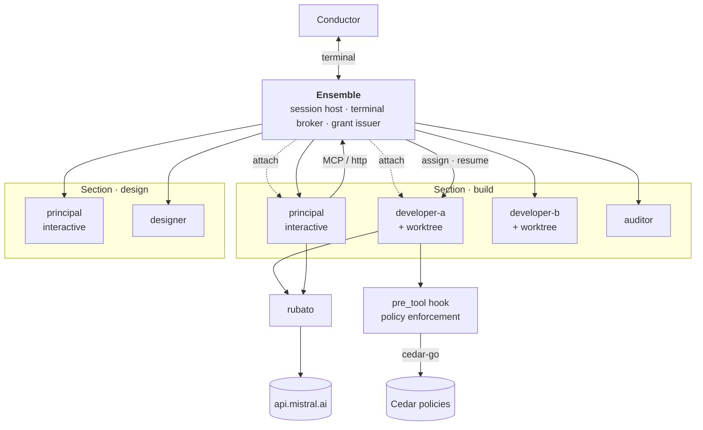
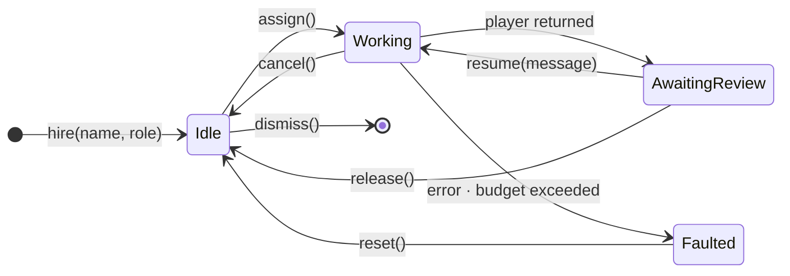
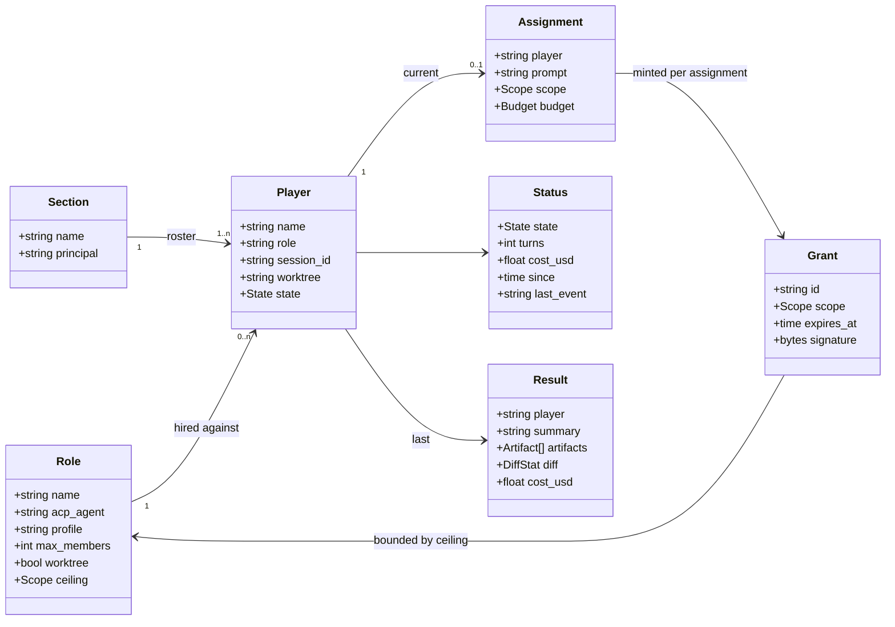
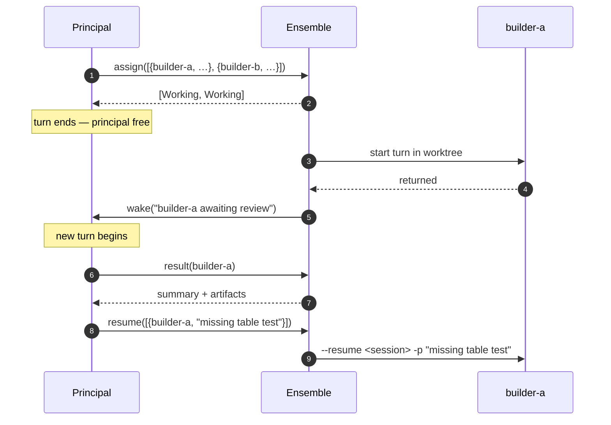
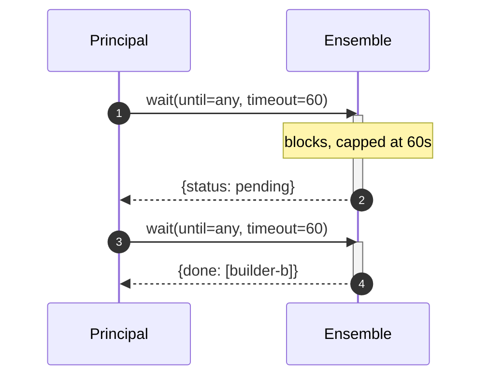
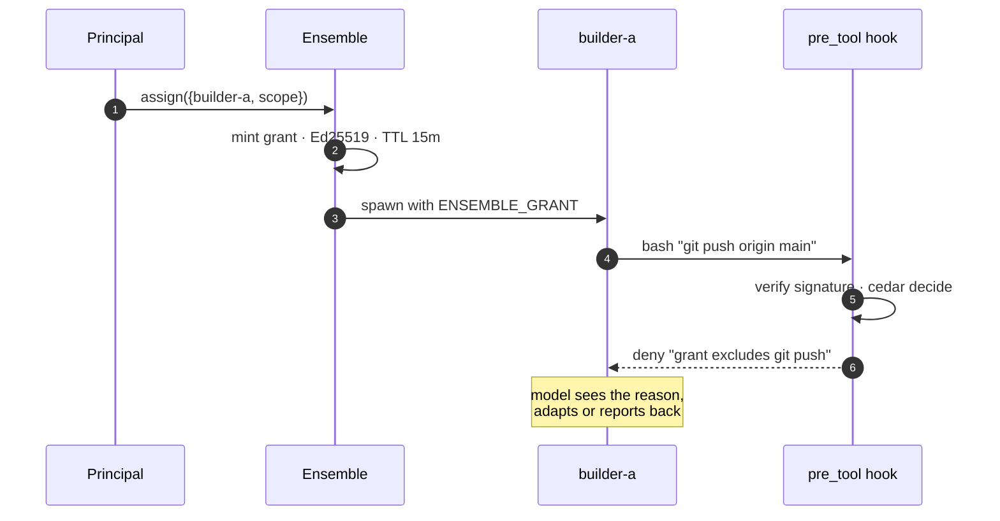

# Ensemble

Design plan. Two frameworks sit between a principal and the section of players it
drives: an **orchestration layer** that schedules work and collects results, and
a **policy layer** that hands out privileges the players cannot exceed.

The ground rules below were established against Mistral Vibe, since that is what
we run. The design is not tied to it: players are driven over ACP, which several
agents implement — see [One protocol, many agents](#one-protocol-many-agents).

The vocabulary is orchestral throughout, and worth stating once:

| Term | Is |
| --- | --- |
| **Conductor** | You. The only party that can be asked a question. |
| **Ensemble** | The process hosting every session. Holds one or more sections. |
| **Section** | A working group with its own roster — a build section, a design section. |
| **Player** | One agent: a role, a durable session, and while working, a worktree. |
| **Principal** | The lead player of a section, and the interactive session you land in. |

## 1. Ground rules

Five properties of Vibe 2.24.1 determine the shape of everything else. Each was
verified against the shipped binary; the published docs are silent on most of
them.

| Property | Consequence |
| --- | --- |
| **Delegation is one level deep.** A subagent's `task` tool refuses every target ([`task.py:97`](https://github.com/mistralai/mistral-vibe/blob/v2.24.1/vibe/core/tools/builtins/task.py)). | Hierarchy cannot live inside a session. Tier 1 must be an external process. |
| **Only user-facing agents can ask questions.** Subagents return text and cannot prompt. | Approval gates sit at the top, with the human. Players never hold one. |
| **Sessions are durable, addressable and resumable.** `--resume <id> -p` re-enters with full context and appends to the same session. | A player *is* a long-lived session. Every follow-up is a resume. |
| **`-p` forces a 385-char headless fragment** ending *"Override any earlier instructions that say to wait for confirmation."* It is hardcoded in `_run_programmatic_mode()`; no flag or env var disables it. | `-p` turns discovered ambiguity into a silent guess. Ruled out as the substrate. |
| **ACP sessions are not headless.** `vibe/acp/agent.py` omits `headless=` from `SessionOptions`, so it defaults to `False` — verified on a live session: 19,354 chars against 19,738 for the same work under `-p`, and no `# Headless Mode` section. | The only verified way found so far to run a player programmatically without the fragment. |
| **ACP sessions are ordinary Vibe sessions.** One created over ACP appears in `~/.vibe/logs/session/` under its `sessionId` like any other. | One session store behind both front-ends, so the conductor can attach with `vibe --resume <id>` whatever drives the player. |

## 2. Architecture

The human runs Ensemble, not Vibe. Ensemble hosts every session — the principal's
included — and brokers the terminal to whichever one the human wants to talk to.
Ensemble is still reached as an MCP server over HTTP for the tool surface, but it
is no longer something that sits *under* a session; it sits around all of them.

The principal is not privileged infrastructure. It is the standard interactive
session, distinguished only by being where you land by default and by holding the
orchestration tools. It is a member of its own roster.

That buys three things the alternative could not:

- **Talk to any member directly** when the principal is the wrong
  interlocutor — reviewing a developer's work with the developer, not through a
  summary of it.
- **More than one section on one Ensemble**, each with its own principal and
  roster: a build section and a design section, side by side.
- **One process that knows every session**, which is what makes both of the above
  cheap rather than bespoke.

Within a section sits a **roster**: a fixed, named set of players rather than an
anonymous worker pool. Each has a role, a durable session and — while working —
a worktree. Names are stable, so `developer-a` is the same colleague across a
whole change, carrying its own accumulated context.

Ensemble owns four things and nothing else: the sections and their rosters, the
mapping from player to Vibe session id, the terminal attachment, and the minting
of grants. It does not interpret results, judge quality, or make plans — those
stay with a principal, which is still the only party that can ask the human.

### Substrate — undecided

How Ensemble drives a player is the largest open decision, and the design above
does not depend on it. The constraint that rules the field: **the headless
fragment is not acceptable**, because it converts ambiguity a player discovers
mid-turn into a silent guess.

| Candidate | Clears the constraint | Standing |
| --- | --- | --- |
| `vibe -p` | No — hardcoded in `_run_programmatic_mode()` | Ruled out |
| **ACP** — [Agent Client Protocol](https://agentclientprotocol.com), JSON-RPC 2.0 over stdio | Yes, verified on a live session | Front-runner |
| `vibe/app_server` directly | Unknown — the core both Vibe front-ends sit on | Unexplored |

ACP leads on evidence: it ran a real turn on our existing credential with no auth
step, returned a typed `stopReason` and token `usage`, and streamed
`session/update` while working. Against it, Mistral documents none of this — but
the protocol is not Mistral's. It is a published standard with an agent registry,
which makes the risk "Mistral's implementation drifts", not "the contract is
someone's private internals".

Remaining unknowns are worth a spike before committing: whether a long-lived
session survives a client reconnect, and what happens to a turn in flight when
the client goes away.

### One protocol, many agents

The consequence that makes ACP more than a workaround: **it is not
Vibe-specific.** Claude Code, Codex CLI, Copilot CLI, OpenCode, Gemini CLI,
Cline, Goose and others implement it, Claude Code through Zed's
[`claude-code-acp`](https://www.npmjs.com/package/@zed-industries/claude-code-acp)
bridge.

So a role names not only *what* a colleague does but *who* it is. A section can
mix vendors — a Claude planner, Vibe developers, whatever suits the seat — and
Ensemble stays a client of one protocol rather than a wrapper around one CLI.

The design therefore stops depending on any single vendor's roadmap, which for
something this early is worth more than the vendor-specific capabilities it gives
up. ACP is not Zed's, either: the spec and the Claude bridge both live under the
neutral `agentclientprotocol` org, Apache-2.0, and Mistral implements the spec
independently.

#### Mixed sections are not free

Vendors differ in how a player is paid for, and one difference is contractual
rather than technical. Anthropic's Agent SDK — which the Claude ACP bridge wraps
— states that *"unless previously approved, Anthropic does not allow third party
developers to offer claude.ai login or rate limits for their products, including
agents built on the Claude Agent SDK"*, directing integrators to API keys.

| Player | Auth | Cost |
| --- | --- | --- |
| Vibe | Mistral account | Included allowance first, then pay-as-you-go |
| Claude | API key, per the terms above | Per token from the first call |

So a Vibe player runs on a subscription we already have, and a Claude player is a
deliberate spend. Start Vibe-only; treat a Claude planner as a decision with a
price attached, not a free upgrade. Changing that is a conversation with
Anthropic, not an engineering task.

#### The protocol standardises the conversation, not the configuration

Every agent-specific knob rides in ACP's `_meta` field, so how a player is
configured differs per agent even though how it is driven does not. Ensemble
needs a small adapter per agent kind — not a rewrite, but not nothing.

The two we care about are not equally capable:

| | Vibe | Claude Code (via bridge) |
| --- | --- | --- |
| System prompt | Base replaceable; ten appended fragments, five gated | `_meta.systemPrompt: "…"` replaces outright, no residue |
| Project instructions | `AGENTS.md`, gated with the git snapshot | `settingSources` controls CLAUDE.md loading |
| Tool restriction | `enabled_tools` / `disabled_tools` per profile | `tools`, `disallowedTools`, `disableBuiltInTools` |
| Policy hook | `.vibe/hooks.toml` on disk | `hooks.PreToolUse` passed by the client at session start |

That last row matters for [§7](#7-enforcement). For a Claude player the enforcement
hook is supplied by Ensemble when the session opens, rather than read from a file
inside the workspace the player can edit — which closes the
enforcer-in-the-blast-radius problem for that agent without needing containers.
Vibe has no equivalent, so the trust boundary is not uniform across a mixed
section. Policy has to assume the weakest member.

### Attaching

Attachment is a view, not a state. The human can drop into any session Ensemble
hosts — but only when that player is not mid-assignment, since a working player's
session is already being driven. So attachment is available in `Idle`,
`AwaitingReview` and `Faulted`.

`AwaitingReview` is the interesting one: it makes "review the work with the
author" a first-class move rather than a thing you approximate by pasting diffs
into the principal.

### Roles are declared, members are hired

The split that keeps section composition from becoming privilege escalation:

- **Roles are declarative.** A role names a kind of colleague — developer,
  auditor, tester — and fixes what that kind is: which ACP agent backs it and
  with what profile, the ceiling on its authority, whether it works in its own
  worktree, and how many may exist. Roles are reviewed artefacts, changed by a
  human.
- **Members are imperative.** Hired and dismissed by the principal at runtime,
  against a declared role, up to its cap. Members are not reviewed.

### Assembling a section

Composing the section is an instruction to the principal, not a deployment step:

> Assemble a section with a developer, an auditor and a tester. If you need to run
> tasks in parallel you may add more developers, up to four.

The principal chooses the shape that fits the work in front of it; the roles
bound what it can choose. Since no call widens a role, a badly judged section costs
a turn rather than becoming an escalation. The headcount ceiling can be config
or a Cedar rule — policy is the better home, because then authority has one
mechanism rather than two.

Sessions start **lazily**, at first assignment. A hired but idle player costs
nothing, which makes hiring cheap enough to do speculatively.

## 3. Player lifecycle

One state machine per player, not per task. A fixed section means concurrency is
bounded by the roster rather than by a queue, and a player is either free or it
is not.

`hire` records a member; the Vibe session is created on the first `assign`.
`reset` discards the session and keeps the name, giving the same player a clean
context — the remedy for a wedged conversation or a `Faulted` player. `dismiss`
removes the member entirely and releases its worktree. Only `Idle` players can be
dismissed, so no assignment is ever orphaned.

`AwaitingReview → Working` is the edge that matters. It resumes the player's
existing session rather than starting a new one: cheaper, since cached input
bills at a tenth of fresh, and correct, since the player keeps the context that
produced the work under review.

`resume` is deliberately general. Rejected output is one reason to resume; a
follow-up question, newly available information, or a change of direction are
others. There is no separate `reject` verb — rejection is just a resume whose
message says what was wrong.

`Faulted` is not retried automatically. A player that ran out of budget mid-edit
has left a worktree in a state a human should see.

## 4. Functional contract

The MCP tool surface. Every call is batch-shaped: each tool boundary is a
potential turn, and every turn re-sends the whole context, so instructing five
players must cost one turn rather than five.

### Tool surface

**Section composition**

| Tool | Blocks | Returns | Semantics |
| --- | --- | --- | --- |
| `roles()` | no | `Role[]` | What may be hired: names, caps, current headcount. Read-only — roles change by review, not by call. |
| `roster()` | no | `Player[]` | The calling principal's own section: names, roles, states, current assignments. |
| `hire(members[])` | no | `Player[]` | `{name, role}` pairs. Fails per-member on duplicate name, unknown role, or cap reached. |
| `dismiss(players[])` | no | `void` | Removes members and releases worktrees. `Idle` players only. |
| `reset(players[])` | no | `Player[]` | Discards the session, keeps the name. Clears a wedged context or a `Faulted` player. |

**Work**

| Tool | Blocks | Returns | Semantics |
| --- | --- | --- | --- |
| `assign(assignments[])` | no | `Player[]` | Put work to named players. Fails per-player if not `Idle`. |
| `assign_sync(assignments[], timeout)` | yes | `Result[]` | Assign and wait in a single turn — the reason it exists. |
| `wait(players?, until, timeout)` | yes | `WaitResult` | `until` is `any` or `all`. Server caps timeout, returns `pending` rather than hanging. |
| `status(players?)` | no | `Status[]` | Cheap poll. Omit `players` for the whole roster. |
| `result(player, full?)` | no | `Result` | Summary by default; `full` returns the diff. |
| `resume(items[])` | no | `Player[]` | `{player, message}` pairs. Continues each session; back to `Working`. |
| `release(players[])` | no | `void` | Work accepted. Player returns to `Idle`, worktree released. |
| `cancel(players[])` | no | `void` | Kills the process, keeps the session for inspection. |

### Invariants

- **No call hangs.** Blocking tools take a server-side cap — 60s working default
  — and return `{status: "pending"}` so the model can call again. MCP requests
  time out at both ends, and a hung tool call also freezes the principal
  against its human.
- **Results are summaries.** Full diffs only on request. Five players reporting
  must not paste five diffs into the principal's context. Ensemble builds a
  `Result` from whatever the substrate returns — the player's final message is
  the summary; reasoning is dropped.
- **Names are stable.** A player keeps its name, session and accumulated context
  across many assignments. That is the point of a roster over a pool.
- **Scope is per assignment, bounded by role.** The grant is minted when work is
  assigned, and is always at or below the role's declared ceiling. No call
  widens a role.
- **The roster is durable.** It survives an Ensemble restart, because player names
  map to Vibe session ids that outlive the process.

### How results reach the principal

Through `wait`, and only through `wait`. A principal is a live interactive
session, and a live session cannot be resumed from outside — so there is no
callback path and no delivery queue. The principal asks; Ensemble answers when
it has something.

Ensemble owns the terminal, so it *could* type into a live session. It does not.
Injecting input into a running TUI makes the principal's transcript a thing
two parties write, which is a bad property to design in for the sake of saving a
poll.

## 5. Dispatch flows

## 6. Policy options

The PAM analogy covers two separable problems, and conflating them is what leads
to building something bespoke.

- **Delegation** — how a grant from the human reaches a player, narrowed on the way.
- **Decision** — whether *this* tool call, with these arguments, is permitted.

| Candidate | Kind | Go support | Verdict | Notes |
| --- | --- | --- | --- | --- |
| **[Cedar](https://github.com/cedar-policy/cedar-go)** | decision engine | `cedar-go` 1.0, official | **pick** | Authored by StrongDM, adopted into the `cedar-policy` org. Fast, analyzable, designed for embedding. No delegation semantics. |
| **[OPA / Rego](https://www.openpolicyagent.org/)** | decision engine | Go-native, embeddable | alt | More expressive than Cedar and CNCF-governed. Heavier, and Rego is a language the section must learn. |
| **[Biscuit](https://www.biscuitsec.org/)** | capability token | `biscuit-go` lags: v1/v2 while Rust and Java are on v3.x | later | Conceptually the closest fit — offline attenuation, Datalog checks, one-way narrowing. The Go lag is the risk. |
| **Macaroons** | capability token | bindings only | no | Biscuit's simpler ancestor. Weaker policy expression, and HMAC verification wants a shared secret. |
| **[UCAN](https://github.com/ucan-wg/spec)** | capability token | `go-ucan` | no | Right delegation model, but drags in DIDs and known token bloat for no benefit we would use. |
| **Casbin** | policy library | Go-native | no | Model-driven RBAC/ABAC. Awkward for rich per-call attributes like a command line or a file path. |

### The load-bearing observation

Offline attenuation exists because the delegating party **cannot reach the
issuer**. Here Ensemble *is* the issuer, and the principal is talking to it over
MCP at the exact moment it assigns work. So Ensemble mints a narrowed, short-lived
grant per assignment and no attenuation format is needed at all.

That removes Biscuit from the critical path. It becomes relevant only if a player
must delegate onward without Ensemble in the loop — which Vibe's depth-1 limit
makes rare, since a player's own subagents run in-process under its grant.

### Recommendation

| Concern | Choice | Why |
| --- | --- | --- |
| Decision | **Cedar**, via `cedar-go` | Evaluated in-process. Policies are data, versioned in the repo, testable without a running fleet. |
| Delegation | **Signed grant** | Ed25519 over a scope document, minted per assignment, minutes-long TTL. A standard primitive, not a bespoke protocol. |
| Deferred | **Biscuit** | Adopt if players ever delegate without Ensemble, and if `biscuit-go` has reached v3 by then. |

## 7. Enforcement

The enforcement point is a `pre_tool` hook, which fires before the permission
prompt and can deny with a reason returned to the model as the tool error. It is
a small Go binary: verify the grant's signature, evaluate the call against Cedar,
allow or deny.

### Design considerations

**Where the trust boundary sits.** The hook runs inside the player it polices, so
it is only as strong as that player's inability to edit it. Three positions:

| Position | Strength | Cost |
| --- | --- | --- |
| Hook alone | Advisory. Adequate while players are fallible rather than adversarial. | None beyond the hook. |
| Hook, denying its own paths | Closes the obvious route. Still one policy bug from disarmed. | Policy must protect itself from version one. |
| Container per player | Boundary is the kernel's. The hook becomes defence in depth. | A player becomes a container, worktrees become mounts, Ensemble becomes a supervisor of containers. |

This is the fork worth settling before any policy is written, because the third
changes the deployment model rather than the configuration. It also changes what
Ensemble is: a process launcher or a container supervisor.

**How sections reach each other.** Open, and worth leaving open. Three positions:
the repo is the medium and sections communicate through branches, OpenSpec changes
and issues; the human is the medium and carries intent across by switching
sessions; or Ensemble relays, with an explicit `message(section, text)` that lands in
the target principal's next turn. The first two need no mechanism and should
be tried first. The third is buildable — Ensemble sees every session — but a section
that can talk to another section's principal is a section that can task it, and the
role ceilings say nothing about that.

**What happens to Ensemble's state when Ensemble dies.** Sessions and the roster
outlive the process, so a restart can reattach names to sessions. The running
`vibe` processes cannot be reattached. Either Ensemble supervises them properly, or
in-flight players come back `Faulted` with their worktrees intact for inspection.
The second is cheaper and honest; it should be a decision rather than a
consequence.

**Whether an assignment is at-most-once.** A worker that edited files and then
lost its result channel has still done the work. Since the worktree persists and
the session is resumable, recovery is inspection rather than replay — which is an
argument for worktrees arriving earlier in the build order than stage 6.

Vibe's own per-profile allow/deny lists remain useful as a coarse first cut —
they cost nothing and fail closed — but they cannot express the three-tier
allow/ask/deny that opencode had, and they are configuration a player could in
principle rewrite. The hook is the real boundary.

## 8. Build order

Each stage is independently useful, and each is a place to stop if the value is
not there.

| Stage | Delivers | Proves |
| --- | --- | --- |
| 1 | Host and attach. Ensemble launches, holds one interactive session, and brokers the terminal to it. | The entrypoint. Ensemble is usable before it orchestrates anything. |
| 2 | Substrate spike. Run one assignment end to end over each candidate — ACP first — and record what the contract returns. | Settles the largest open decision, and fixes the shape of `Result`. |
| 3 | Roles, `roster`, `hire`, `dismiss`, `reset`. Durable across restart. | A section can be composed and survives Ensemble dying. |
| 4 | `assign`, `wait`, `result`, with a worktree per player. | Work goes out and comes back, and each player has working state of its own to review. |
| 5 | `resume`, and attach in `AwaitingReview`. | The review loop — including reviewing with the author rather than about them. |
| 6 | Grants and the Cedar hook. | A player is provably unable to exceed its role's ceiling. |
| 7 | A second section. | Sections are a first-class boundary, not a rename of roster. |

